# BigWarn — Real-Time Disruption Alert Architecture

This document describes the end-to-end architecture, the components added across the **Medallion ELT + Spark backend** and the **React Native + OpenStreetMap mobile edge app**, and how data flows from 45 Bangladesh news portals to route-filtered mobile push alerts.

---

## 1. End-to-End Data Flow

```mermaid
flowchart LR
    S["45 Bangladesh News Portals\n(Bilingual EN + BN Scraper)"] -->|"Live JSONL / Kafka Stream"| B["Bronze Layer\nRaw Articles (Unfiltered)"]
    B -->|"Spark / ELT Filter + Deduplicate\n+ OSM Area Geocoding"| Si["Silver Layer\nCleansed Disruptions"]
    Si -->|"Group by (Date, Area, Event)\n+ Multi-Source Veracity Score"| G["Gold Layer\nCorroborated Area Alerts"]
    G -->|"Haversine + Point-to-Segment\nCorridor Filter"| R["Route-Aware API & SSE Stream\n(/api/v1/alerts/route, /stream/alerts)"]
    R -->|"Route-Only Alerts\n+ Map Clusters"| M["React Native Edge App\n(OpenStreetMap + Veracity Meter\n+ Local Push Sound Alerts)"]
```



---

## 2. Backend Architecture (ELT, Spark, Route Filtering & Streaming)

### 2.1 Medallion Lakehouse ELT (`backend/lakehouse/elt/medallion_manager.py`)
Materializes and queries the three Medallion layers under `backend/lakehouse/storage/`:
- **Bronze (`bronze/articles/bronze_articles_<date>.jsonl`)**: Stores raw ingested articles as-is with source metadata, language, timestamps, and word counts.
- **Silver (`silver/disruptions/silver_disruptions_<date>.jsonl`)**: Filters for disruption-relevant articles (`is_disruption` / `event_types`), deduplicates by normalized headline, and enriches each record with OpenStreetMap coordinates (`lat`, `lon`, `city`) from `AREA_METADATA`.
- **Gold (`gold/area_alerts/gold_alerts_<date>.json`)**: Clusters Silver records by `(date, area, event_type)` and computes:
  - **Veracity / Credibility Score**:
    $$\text{score} = \min\left(0.99,\; 0.45 + 0.18 \times N_{\text{sources}} + (0.08 \text{ if bilingual})\right)$$
  - **Veracity Tiers**:
    - `VERIFIED (Multi-Source)` (`HIGH`, $\ge 3$ sources)
    - `CONFIRMED` (`MEDIUM`, $2$ sources)
    - `UNCONFIRMED (Single Source)` (`LOW`, $1$ source)
  - **Severity & Map Color Coding**:
    - `#EF4444` (Red / `CRITICAL`): `blockade`, `strike`, `clash`, `fire`
    - `#F59E0B` (Amber / `HIGH`): `procession`, `accident`
    - `#3B82F6` (Blue / `MODERATE`): `waterlogging`, `power_outage`

### 2.2 Apache Spark Cloud Processing (`backend/streaming/spark/elt_jobs.py`)
Implements the distributed PySpark pipeline mirroring the Medallion rules:
- `run_bronze_stream_job()` — Structured Streaming ingestion from JSONL/Kafka into partitioned Parquet.
- `run_silver_elt_job()` — Disruption filtering, headline deduplication, and OSM coordinate mapping.
- `run_gold_elt_job()` — Multi-source aggregation, bilingual corroboration, and veracity scoring.
- `run_batch_medallion_elt()` — CLI entrypoint (`python3 -m backend.streaming.spark.elt_jobs --stage batch|bronze|silver|gold`).

### 2.3 Route-Aware Relevance Engine (`backend/app/services/route_service.py`)
Prevents alert fatigue by emitting **only** disruptions relevant to the user's active trip:
- Uses **Haversine distance** and **point-to-segment projection** (`point_to_segment_km`) on a local tangent plane to measure how close each Gold alert cluster is to the line between `current_location` and `destination` (pinned on the map or selected from presets).
- Matches alerts within `2.5 km` of the route corridor, `3.0 km` of the destination pin, or explicitly mentioned in the user's `todo` text.
- Computes `route_risk_level` (`BLOCKED`, `HIGH_RISK`, `CAUTION`, `CLEAR`) and `suppressed_count` (number of unrelated city alerts filtered out).

### 2.4 Cached Stream Service & REST/SSE API (`backend/app/services/stream_service.py`, `backend/app/api/server.py`, `backend/app/core/config.py`)
- **In-Memory File-Signature Cache**: Caches the latest Medallion snapshot keyed by `(file_path, size, mtime)` and pre-warms it on server startup so mobile requests complete in **< 1 ms** while automatically refreshing when new articles arrive.
- **Endpoints**:
  - `GET /api/v1/alerts/route?date=latest&cur_lat=...&cur_lon=...&dest_lat=...&dest_lon=...&todo=...&include_map=1` — returns route-filtered alerts, risk level, suppressed count, and (when `include_map=1`) all city Gold clusters in a single request.
  - `GET /api/v1/alerts/map?date=latest` — returns all Gold area clusters for map exploration.
  - `GET /api/v1/stream/alerts` — Server-Sent Events (`text/event-stream`) endpoint emitting live map or route-filtered alerts.
  - `GET /api/v1/lakehouse?date=latest`, `GET /api/v1/sources`, `GET /api/v1/health`.
- Default `api_host` is `0.0.0.0:8765` so mobile devices on the same Wi-Fi LAN can connect directly.

---

## 3. Mobile Edge App (`real-time-alert/mobile/`, Expo SDK 58 / React Native)

| File | Responsibility |
| :--- | :--- |
| `App.tsx` | Full-screen map layout, floating glassmorphic todo/pin planner, Route Anomaly banner, bottom-right GPS/map controls, collapsible Route Alerts sheet, and `@expo/vector-icons` UI. |
| `src/components/OsmMapWebView.tsx` | Interactive OpenStreetMap (Leaflet + OSM tiles in `react-native-webview`) with pulsing blue GPS dot, tap-to-pin destination marker, dashed route polyline, translucent danger circles (`L.circle`), and crisp color-coded area badges. |
| `src/components/VeracityMeter.tsx` | Visual credibility gauge (`veracity_percent%`), status badge, and corroborating newspaper/portal chips. |
| `src/components/AreaDetailModal.tsx` | Bottom-sheet modal opened when tapping any map marker (e.g. `Mirpur-10`), listing all disruption clusters, Veracity Meters, and clickable news headlines. |
| `src/services/notifications.ts` | Configures `expo-notifications` (`MAX` importance Android channel + foreground sound/banner + vibration) and fires deduplicated local push notifications with sound when a new `CRITICAL`/`HIGH` anomaly hits the user's route. |
| `src/config/api.ts` | Auto-detects the Mac's LAN IP via `ExpoUpdates` / `ExponentConstants` / `SourceCode` (with fallback to `192.168.0.104:8765`) and provides Dhaka area coordinate presets. |
| `src/types/alert.ts` | Shared TypeScript interfaces for Gold alerts, route responses, Lakehouse stats, and coordinates. |

---

## 4. Running the System

1. **Start the Backend API** (from `real-time-alert/`):
   ```bash
   python3 backend/run_api.py --host 0.0.0.0 --port 8765
   ```
2. **(Optional) Run the Live 45-Paper Scraper** (from `real-time-alert/`):
   ```bash
   python3 backend/run_streamer.py
   ```
3. **Start the Mobile App** (from `real-time-alert/mobile/` on Node 22+):
   ```bash
   npm install
   npx expo start -c
   ```
