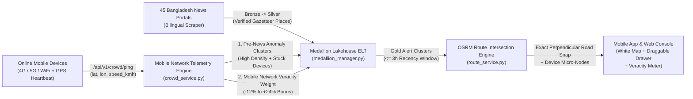

# BigWarn — Mobile Network Crowd Density & Mobility (Moving vs. Stuck) Intelligence

This document describes BigWarn's **Google-Maps-style Passive Mobile Network Connectivity, Device Density, and Mobility (Moving vs. Stuck) Analysis Engine**.

By analyzing anonymous connectivity heartbeats from online mobile devices in the same spatial cell (`135m–180m` radius), BigWarn determines:
1. **How dense an area is** (`online_devices`, `devices_per_100m`, and `surge_ratio` vs. normal baseline).
2. **Whether people and vehicles at that position are MOVING or STUCK / STATIONARY** (`stuck_percent`, `moving_percent`, `avg_speed_kmh`, and stationary `dwell_minutes`).
3. **Pre-News Early Disruption Alerting**: Emits early alerts during a **strike**, **road blockade**, **fire**, or **clash** *before* newspapers publish an article.
4. **Hybrid News Veracity Weighting**: Weights the credibility/veracity score of published news articles using live mobile network telemetry at the event coordinates.

---

## 1. End-to-End Architecture



---

## 2. How Mobile Network Density & Mobility Detection Works

### 2.1 Spatial Device Clustering & Density Surge
For every canonical Bangladesh & Dhaka area in `AREA_METADATA`, the telemetry engine tracks the number of active online mobile devices within a `135m–180m` hotspot radius ($R$):

$$\text{Surge Ratio} = \frac{N_{\text{online\_devices}}}{N_{\text{baseline}}}$$

$$\text{Devices per 100m} = \frac{N_{\text{online\_devices}}}{R / 100}$$

- **High-Density Urban Hubs** (e.g., `Motijheel`, `Mirpur-10`, `Shahbagh`, `Farmgate`, `Uttara`, `Jatrabari`): $N_{\text{baseline}} \approx 115\text{–}135$ devices.
- **Standard Areas / Districts**: $N_{\text{baseline}} \approx 65$ devices.

### 2.2 Mobility Classification: Moving vs. Stuck / Stationary
Each online mobile device heartbeat carries instantaneous velocity ($v$ in $\text{km/h}$). Devices with $v \le 2.8\text{ km/h}$ are classified as **Stuck / Stationary**:

$$\text{Stuck \%} = \frac{N_{\text{stuck}}}{N_{\text{online\_devices}}} \times 100, \qquad \text{Moving \%} = 100 - \text{Stuck \%}$$

| Event / Traffic Signature | Device Density Surge | Stuck / Stationary % | Average Speed | Dwell Time | Mobility State Classification |
| :--- | :--- | :--- | :--- | :--- | :--- |
| **Strike / Road Blockade** | $\ge 3.0\times$ ($400\text{–}600+$ devices) | **$85\% \text{–} 96\%$ Stuck** | $0.6 \text{–} 1.5\text{ km/h}$ | $15 \text{–} 30+\text{ min}$ | `STUCK / GRIDLOCKED` |
| **Fire / Arson / Clash** | $\ge 2.5\times$ ($300\text{–}450+$ devices) | **$78\% \text{–} 90\%$ Stationary** | $1.0 \text{–} 2.2\text{ km/h}$ | $12 \text{–} 25\text{ min}$ | `STATIONARY CLUSTER` |
| **Moderate Congestion** | $1.6\times \text{–} 2.4\times$ | $55\% \text{–} 74\%$ Slow | $3.5 \text{–} 8.5\text{ km/h}$ | $6 \text{–} 11\text{ min}$ | `SLOW / CONGESTED` |
| **Normal Traffic Flow** | $0.8\times \text{–} 1.4\times$ | $< 35\%$ Stuck | $16.0 \text{–} 28.0\text{ km/h}$ | $\le 2\text{ min}$ | `MOVING FREELY` |

---

## 3. Pre-News Early Alerting & Hybrid Veracity Scoring

### 3.1 Pre-News Mobile Network Alerting (Before Media Publication)
When a **fire** breaks out or a **strike / blockade** halts an intersection, hundreds of mobile devices accumulate and stop moving at that coordinate **15 to 30 minutes before** reporters write and publish a news article.

When the engine detects:
- $\text{Surge Ratio} \ge 2.2\times$ **AND** $\text{Stuck \%} \ge 65\%$ in an area with no published news cluster yet,
it emits a **`PRE-NEWS MOBILE NETWORK ALERT`** (`alert_origin: "PRE_NEWS_CROWD"`, `is_pre_news_crowd: true`) directly into the Gold Medallion layer with confidence:

$$\text{PreNewsConfidence} = \min\Big(0.95,\; 0.50 + \min\big(0.24,\; (\text{SurgeRatio} - 1.0) \times 0.08\big) + \Delta_{\text{stuck}}\Big)$$

where $\Delta_{\text{stuck}} = +0.16$ if $\text{Stuck \%} \ge 80\%$, or $+0.10$ if $\text{Stuck \%} \ge 65\%$.

### 3.2 Hybrid News + Mobile Network Veracity Formula
When newspapers publish disruption reports for an area, BigWarn combines **Newspaper Corroboration** with **Live Mobile Network Telemetry** (`crowd_weight_bonus` $\in [-0.12, +0.24]$):

$$\text{MediaBase} = 0.42 + 0.16 \times N_{\text{sources}} + \begin{cases} 0.07 & \text{if bilingual (EN + BN)} \\ 0.00 & \text{otherwise} \end{cases}$$

$$\text{MobileNetworkWeight} = \begin{cases}
+0.16 + \min(0.08, 0.02 \times N_{\text{signals}}) & \text{if Stuck \%} \ge 75\% \text{ and SurgeRatio} \ge 2.4\times \\
+0.11 + \min(0.08, 0.02 \times N_{\text{signals}}) & \text{if Stuck \%} \ge 60\% \text{ and SurgeRatio} \ge 1.8\times \\
-0.08 & \text{if Stuck \%} < 35\% \text{ (devices moving freely)}
\end{cases}$$

$$\text{FinalVeracityScore} = \min\big(0.99,\; \max(0.25,\; \text{MediaBase} + \text{MobileNetworkWeight})\big)$$

- **Corroboration Boost**: If a single newspaper reports a fire or blockade at `Mirpur-10`, and mobile network telemetry confirms `520 online devices` with `92% STUCK (0.9 km/h)`, the veracity score jumps by **`+18% to +24%`**.
- **False-Alarm Suppression**: If an unconfirmed single source claims a road blockade, but mobile network telemetry shows `88% MOVING (22 km/h)`, the veracity score is down-weighted by **`-8% to -12%`**.

---

## 4. Map & Route Visualization Rules

1. **Strict 3-Hour Active Window (`<= 180 minutes`)**:
   - Only active events within the last **3 hours** (`is_recent_3h: true`) trigger route hazard red dots and route alerts. Older historical alerts are automatically skipped.
2. **Exact Perpendicular Road-Segment Projection**:
   - Both [route_service.py](file:///Users/sabihakhairohi/Projects/news-alert/real-time-alert/backend/app/services/route_service.py) and [OsmMapWebView.tsx](file:///Users/sabihakhairohi/Projects/news-alert/real-time-alert/mobile/src/components/OsmMapWebView.tsx) project each active (`<= 3h`) event coordinate `(a_lat, a_lon)` perpendicularly onto every segment $A \to B$ of the rendered OSRM road polyline:
     $$\hat{t} = \max\left(0,\; \min\left(1,\; \frac{(\mathbf{p} - \mathbf{a}) \cdot (\mathbf{b} - \mathbf{a})}{\|\mathbf{b} - \mathbf{a}\|^2}\right)\right), \qquad \mathbf{p}_{\text{snap}} = \mathbf{a} + \hat{t}(\mathbf{b} - \mathbf{a})$$
   - The blinking red dot is placed at the **exact closest road coordinate** $\mathbf{p}_{\text{snap}}$ (`tooltip_lat`, `tooltip_lon`), and the intercepted road stretch is highlighted in pulsing red.
3. **Stuck vs. Moving Device Micro-Nodes on the White Map**:
   - Around each active hotspot, [OsmMapWebView.tsx](file:///Users/sabihakhairohi/Projects/news-alert/real-time-alert/mobile/src/components/OsmMapWebView.tsx) renders micro-dots representing the detected cluster of online mobile devices:
     - **Red micro-dots (`#DC2626`)**: Stuck / stationary mobile devices ($v \le 2.8\text{ km/h}$).
     - **Green micro-dots (`#10B981`)**: Moving mobile devices ($v > 2.8\text{ km/h}$).

---

## 5. REST API Endpoints

### 5.1 Automatic Device Connectivity & Mobility Ping
- **Endpoint**: `GET` or `POST /api/v1/crowd/ping`
- **Query / JSON Parameters**:
  ```json
  {
    "device_id": "mobile-edge-01",
    "lat": 23.8069,
    "lon": 90.3687,
    "speed_kmh": 0.9,
    "network_type": "4G_LTE"
  }
  ```
- **Response**:
  ```json
  {
    "status": "ok",
    "telemetry": {
      "area": "Mirpur-10",
      "distance_km": 0.0,
      "is_stuck": true,
      "speed_kmh": 0.9,
      "active_edge_pings": 1
    }
  }
  ```

### 5.2 Simulate / Submit Mobile Network Density Cluster
- **Endpoint**: `POST` or `GET /api/v1/crowd/report`
- **JSON Payload**:
  ```json
  {
    "area": "Mirpur-10",
    "event_type": "strike",
    "gathering_size": 520,
    "avg_speed_kmh": 0.8,
    "stuck_percent": 93,
    "note": "520 online mobile devices stuck at Mirpur-10 intersection (0.8 km/h)"
  }
  ```

### 5.3 Update Area Mobility State (`Stuck` vs. `Moving`)
- **Endpoint**: `POST` or `GET /api/v1/crowd/vote`
- **JSON Payload**:
  ```json
  {
    "area": "Motijheel",
    "event_type": "fire",
    "vote": "confirm"
  }
  ```
  *(Pass `"confirm"` when devices are stuck/accumulating at the location, or `"clear"` when traffic/devices are moving freely.)*

---

## 6. Key Files Modified

| File | Role |
| :--- | :--- |
| [crowd_service.py](file:///Users/sabihakhairohi/Projects/news-alert/real-time-alert/backend/app/services/crowd_service.py) | Mobile network device density, stuck-vs-moving velocity classifier, micro-dot generator, pre-news cluster generator, and veracity weight calculator. |
| [medallion_manager.py](file:///Users/sabihakhairohi/Projects/news-alert/real-time-alert/backend/lakehouse/elt/medallion_manager.py) | Injects `crowd_metrics` and pre-news mobile network alerts into the Gold Medallion layer and computes hybrid News + Mobile Network veracity scores. |
| [route_service.py](file:///Users/sabihakhairohi/Projects/news-alert/real-time-alert/backend/app/services/route_service.py) | Enforces the 3-hour recency filter (`<= 180 min`) and computes exact perpendicular point-to-segment road projection for blinking red hazard dots. |
| [server.py](file:///Users/sabihakhairohi/Projects/news-alert/real-time-alert/backend/app/api/server.py) | Exposes `/api/v1/crowd/ping`, `/api/v1/crowd/report`, and `/api/v1/crowd/vote`. |
| [OsmMapWebView.tsx](file:///Users/sabihakhairohi/Projects/news-alert/real-time-alert/mobile/src/components/OsmMapWebView.tsx) | Google-Maps-style white OSM basemap, exact road-snap blinking red dots, and red/green stuck-vs-moving mobile device cluster micro-nodes. |
| [VeracityMeter.tsx](file:///Users/sabihakhairohi/Projects/news-alert/real-time-alert/mobile/src/components/VeracityMeter.tsx) | Displays online device density, `% STUCK` vs. `% MOVING` dual-color ratio bar, average speed (`km/h`), stationary dwell time, and `+XX% Net` veracity weight. |
| [App.tsx](file:///Users/sabihakhairohi/Projects/news-alert/real-time-alert/mobile/App.tsx) | Automatic `/api/v1/crowd/ping` heartbeat, gesture-driven draggable bottom drawer (drag to open / drag to off), and Mobile Network Telemetry simulator modal. |
