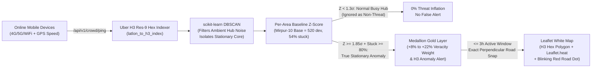

# BigWarn — Uber H3 + DBSCAN Mobile Network Crowd & Mobility Intelligence

This document describes BigWarn's **Uber H3 Hexagonal Spatial Indexing + `scikit-learn` DBSCAN Stationary Core Clustering + Baseline-Normalized Mobile Network Telemetry Engine**.

---

## 1. Why Raw Crowd Size Alone Is Not a Threat (The Mirpur-10 Optimization)

In major urban hubs across Dhaka and Bangladesh—such as **Mirpur-10**, **Motijheel**, **Farmgate**, **Shahbagh**, **Gulistan**, **Jatrabari**, and **New Market**—having **450 to 600+ active mobile devices** and **50%+ slow or stopped traffic** at traffic signals is **100% normal everyday activity**.

If a system simply alerts whenever $>300$ devices gather in one place, naturally crowded hubs like **Mirpur-10** would trigger false threat alerts all day.

To solve this, BigWarn implements a **3-Stage Baseline-Normalized H3 + DBSCAN Pipeline**:
1. **Uber H3 Resolution-9 Hexagonal Indexing (`~100m` cell edge, `~0.105 km²` area)**:
   Every GPS/network heartbeat is indexed into an H3 hexagon cell (`h3_index`, e.g., `893c06a4c27ffff`) with its own **Historical Area Baseline Profile** ($\mu_{\text{devices}}, \sigma_{\text{devices}}, \mu_{\text{stuck\%}}, \sigma_{\text{stuck\%}}$).
2. **`scikit-learn` DBSCAN Spatial Noise Filtering (`eps = 85m`, `min_samples = 3`, `metric = "haversine"`)**:
   Separates **scattered ambient shoppers/pedestrians** (`ambient_noise_devices`, label `-1`) from **tightly locked stationary road/incident bottleneck cores** (`dbscan_core_devices`).
3. **Baseline-Normalized Anomaly Z-Score ($Z_{\text{H3}}$ in standard deviations $\sigma$)**:
   Measures how far the current H3 cell's stuck device core deviates from **that specific location's normal everyday crowd baseline**:
   - If $Z_{\text{H3}} < +1.3\sigma$ (e.g., 520 devices at Mirpur-10 with 54% stopped at normal signals): Classified as **`NORMAL HUB BASELINE (Non-Threat Crowd)`** $\to$ **No threat alert is emitted, and `0%` false veracity boost is added.**
   - Only when a multi-sigma stationary anomaly occurs ($Z_{\text{H3}} \ge +1.85\sigma$ to $+3.0\sigma$ above that hub's normal baseline, with $\ge 80\%$ of devices stuck at $\le 1.8\text{ km/h}$) does it count as an **Anomalous H3 Gridlock / Stationary Core**!

---

## 2. End-to-End Architecture

---

## 3. Per-Area H3 Baseline Tiers & Anomaly Z-Score Formula

### 3.1 Three-Tier Historical Baseline Profiles (`get_area_baseline_profile`)

| Tier | Example Bangladesh & Dhaka Locations | Normal Baseline ($\mu_{\text{dev}} \pm \sigma_{\text{dev}}$) | Normal Signal Stop % ($\mu_{\text{stuck}} \pm \sigma_{\text{stuck}}$) | Normal Hub Speed |
| :--- | :--- | :--- | :--- | :--- |
| **Tier 1: Mega-Crowd Hubs** | `Mirpur-10`, `Motijheel`, `Farmgate`, `Shahbagh`, `Gulistan`, `New Market`, `Karwan Bazar`, `Jatrabari`, `Mohakhali`, `Uttara`, `Paltan`, `Chattogram` | **$520 \pm 145$ devices** | **$54\% \pm 12\%$** | $8.5\text{ km/h}$ |
| **Tier 2: Commuter Corridors** | `Dhanmondi`, `Banani`, `Gulshan`, `Mirpur-1`, `Mirpur-11`, `Mirpur-12`, `Shyamoli`, `Agargaon`, `Tejgaon`, `Airport`, `Kuril`, `Gazipur`, `Narayanganj`, `Sylhet` | **$280 \pm 85$ devices** | **$38\% \pm 11\%$** | $14.0\text{ km/h}$ |
| **Tier 3: Standard / District** | Low-density residential wards & district highways | **$110 \pm 40$ devices** | **$20\% \pm 9\%$** | $22.0\text{ km/h}$ |

### 3.2 Anomaly Z-Score ($Z_{\text{H3}}$) Calculation
For an H3 cell $h$ with observed online devices $N_{\text{obs}}$ and observed stuck percentage $S_{\text{obs}}$:

$$Z_{\text{density}}(h) = \frac{N_{\text{obs}} - \mu_{\text{dev}}(h)}{\sigma_{\text{dev}}(h)}, \qquad Z_{\text{stuck}}(h) = \frac{S_{\text{obs}} - \mu_{\text{stuck}}(h)}{\sigma_{\text{stuck}}(h)}$$

$$Z_{\text{H3}}(h) = 0.45 \cdot Z_{\text{density}}(h) + 0.55 \cdot Z_{\text{stuck}}(h)$$

### 3.3 Hybrid Veracity Weighting Rule
When newspapers report a disruption event in cell $h$, the H3 telemetry weights the news veracity score as follows:

$$\text{H3VeracityWeight} = \begin{cases}
+0.16 \text{ to } +0.22 & \text{if } Z_{\text{H3}} \ge +2.2\sigma \text{ and } S_{\text{obs}} \ge 80\% \text{ (Severe Stationary Anomaly)} \\
+0.08 \text{ to } +0.13 & \text{if } +1.35\sigma \le Z_{\text{H3}} < +2.2\sigma \text{ and } S_{\text{obs}} \ge 68\% \text{ (Elevated Anomaly)} \\
\mathbf{0.00} & \text{if } +0.6\sigma \le Z_{\text{H3}} < +1.35\sigma \text{ (Normal Busy Hub Crowd — Non-Threat)} \\
-0.06 \text{ to } -0.12 & \text{if } Z_{\text{H3}} < +0.6\sigma \text{ (Traffic Flowing Normally / False Blockade Claim)}
\end{cases}$$

---

## 4. Map & UI Visualization (`OsmMapWebView.tsx` & `VeracityMeter.tsx`)

1. **Uber H3 Resolution-9 Hexagonal Cell Boundary (`L.polygon`)**:
   - Drawn around active (`<= 3h`) events on the Google-Maps-style white basemap (`#DC2626` red hexagon when intercepted by the user's route; `#7C3AED` purple dashed hexagon for off-route clusters).
2. **`Leaflet.heat` Thermal Crowd Density Layer (`L.heatLayer`)**:
   - Renders a smooth thermal density gradient (`#FDE047` $\to$ `#F97316` $\to$ `#DC2626`) over the DBSCAN core stuck device coordinates.
3. **DBSCAN Core Stuck vs. Moving Micro-Nodes**:
   - **Red micro-dots (`#DC2626`)**: DBSCAN core stuck mobile devices ($v \le 2.8\text{ km/h}$).
   - **Green micro-dots (`#10B981`)**: Ambient moving mobile devices ($v > 2.8\text{ km/h}$).
4. **Strict 3-Hour Filter & Exact Perpendicular Road-Snap Blinking Red Dot**:
   - Events older than 3 hours (`age_minutes > 180`) are skipped from route alerts and route red dots.
   - Active (`<= 3h`) events near the route (`<= 1.35 km`) snap their blinking red hazard dot to the **exact mathematical perpendicular projection** `(snapLat, snapLon)` on the OSRM road polyline.
