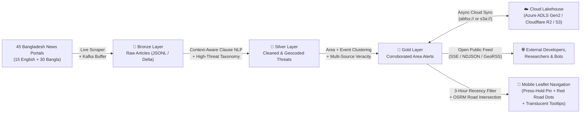

# 🚨 BigWarn — Open-Source Real-Time Bangladesh Threat & Disruption Stream, Medallion Lakehouse & Road Navigation Platform

[](#license)
[-blue)](#1-architecture-overview)
[-amber)](#3-how-the-core-functions-work-codebase-walkthrough)
[](#2-public-open-stream--feed-api-connect--consume)

**BigWarn** is an open-source, real-time news ingestion, Medallion Data Lakehouse (**Bronze $\rightarrow$ Silver $\rightarrow$ Gold**), and privacy-first road navigation alert platform for Bangladesh.

It continuously crawls **45 major Bangladeshi newspapers and online portals** (15 English + 30 Bangla), extracts active public safety threats (**gunfire/explosions, murder/violent crime, arson/vehicle fires, violent clashes, road/rail blockades, strikes, and fatal accidents**), geocodes incidents to OpenStreetMap coordinates, and exposes both:
1. **An Open Public Real-Time Data Stream (`SSE`, `NDJSON/JSONL`, `JSON`, `GeoRSS`)** that any developer, researcher, or external application can connect to and consume.
2. **A Google Maps-Style Mobile Leaflet Navigation App** where commuters press-and-hold to drop a destination pin, navigate along actual streets via **OSRM**, and see **Red Hazard Dots (`🔴`)** with translucent tooltips on roads affected by threats within the last **3 hours**.

---

## 1. Architecture Overview



### Monorepo Directory Structure (Separation of Concerns)

```text
real-time-alert/
├── backend/                                  # Autonomous Data Foundry, Lakehouse ELT & Stream API
│   ├── app/
│   │   ├── api/server.py                     # Multi-threaded REST, SSE, NDJSON & GeoRSS Stream Server
│   │   ├── core/config.py                    # Central config, Dhaka UTC+6 timezone & Cloud settings
│   │   └── services/
│   │       ├── stream_service.py             # Public feed query engine, RSS builder & snapshot cache
│   │       └── route_service.py              # OSRM real-road routing & polyline hazard intersection
│   ├── ingestion/
│   │   ├── enrichment/taxonomy.py            # Context-aware bilingual threat & clause-level location NLP
│   │   ├── scraper/parser.py                 # HTML, RSS, Sitemap & JSON-LD article body extractor
│   │   ├── sinks/kafka_sink.py               # Stage 2 Apache Kafka producer (bigwarn.raw.news)
│   │   └── sources/registry.py               # Metadata registry for 45 BD portals (15 EN + 30 BN)
│   ├── lakehouse/
│   │   ├── elt/
│   │   │   ├── medallion_manager.py          # Bronze -> Silver -> Gold ELT & veracity scoring engine
│   │   │   └── cloud_lakehouse.py            # Async Azure ADLS Gen2 & Cloudflare R2 / S3 sync connector
│   │   └── storage/                          # Materialized Bronze, Silver & Gold partitions on disk
│   ├── streaming/spark/elt_jobs.py           # Distributed PySpark Structured Streaming & Delta Lake jobs
│   ├── run_streamer.py                       # CLI entrypoint for the 45-portal live crawler
│   └── run_api.py                            # CLI entrypoint for the REST & Public Stream API server
├── mobile/                                   # React Native (Expo) + Leaflet Real-Road Navigation App
│   ├── App.tsx                               # Main navigation screen, route state & collapsible drawer
│   └── src/
│       ├── components/
│       │   ├── OsmMapWebView.tsx             # Leaflet map, press-hold pin, OSRM roads & translucent popups
│       │   ├── AreaDetailModal.tsx           # Newest-first news drawer with publish timestamps
│       │   └── VeracityMeter.tsx             # Multi-source credibility & veracity meter
│       ├── config/api.ts                     # Auto-detected LAN host & Dhaka presets
│       └── services/notifications.ts         # Event labels & Dhaka timestamp formatters
├── frontend/                                 # Next.js 14 Web Observatory, Lakehouse Explorer & PWA
└── docs/                                     # Detailed architecture & development guides (.md & .docx)
```

---

## 2. Public Open Stream & Feed API (Connect & Consume)

Anyone can connect to the BigWarn API server (default `http://localhost:8765`) to consume the live Bangladesh news and threat stream in **4 formats**: **JSON**, **NDJSON (`application/x-ndjson`)**, **Server-Sent Events (`text/event-stream`)**, and **RSS 2.0 + GeoRSS (`application/rss+xml`)**.

### 2.1 Stream & Feed Endpoints

| Endpoint | Default Format | Default Layer | Description |
| :--- | :--- | :--- | :--- |
| `GET /api/v1/stream/feed` | `json` | `gold` | Unified queryable feed supporting `?layer=`, `?format=`, `?area=`, `?event_type=`, `?lang=`, `?recent_hours=`, `?after=`, `?limit=`. |
| `GET /api/v1/stream/live` | `sse` | `silver` | **Live Server-Sent Events (`text/event-stream`) firehose** pushing newly scraped threat articles in real time. |
| `GET /api/v1/feed.jsonl` | `ndjson` | `silver` | **Newline-Delimited JSON (`JSONL`) stream** ready for `curl`, `jq`, Apache Spark, DuckDB, or Pandas. |
| `GET /api/v1/feed.rss` | `rss` | `gold` | **RSS 2.0 + GeoRSS XML feed** with `<georss:point>lat lon</georss:point>` coordinates for RSS readers and GIS tools. |
| `GET /api/v1/alerts/route` | `json` | `gold` | Computes real OSRM road route between `(cur_lat, cur_lon)` and `(dest_lat, dest_lon)` and returns red danger road stretches (`<= 3h`). |

### 2.2 Query Parameters for `/api/v1/stream/feed`

* `layer`: `gold` (corroborated area alert clusters), `silver` (cleaned & geocoded threat articles), or `bronze` (all raw articles from 45 portals).
* `format`: `json`, `ndjson` (or `jsonl`), `sse` (live Server-Sent Events), or `rss` (RSS 2.0 + GeoRSS XML).
* `area`: Filter by location name (e.g., `Banani`, `Mohakhali`, `Mirpur-10`, `Jatrabari`, `Chattogram`).
* `event_type`: Filter by threat type (`gunfire`, `murder`, `fire`, `clash`, `blockade`, `strike`, `procession`, `accident`, `waterlogging`, `power_outage`).
* `lang`: Filter by language (`bn` or `en`).
* `recent_hours`: Only return alerts/articles published within the last $N$ hours (e.g., `recent_hours=3`).
* `after` & `limit`: Cursor pagination (`?after=0&limit=100`).

### 2.3 Quick Connection Examples

#### A. Connect to the Live Real-Time SSE Firehose (`curl`)
```bash
# Stream live threat-enriched Silver articles as they arrive
curl -N "http://localhost:8765/api/v1/stream/live"

# Stream only gunfire/bomb or fire alerts in Dhaka from the last 3 hours
curl -N "http://localhost:8765/api/v1/stream/feed?layer=gold&format=sse&recent_hours=3"
```

#### B. Consume in JavaScript / TypeScript (`EventSource`)
```javascript
const stream = new EventSource("http://localhost:8765/api/v1/stream/feed?layer=gold&format=sse&recent_hours=3");

stream.addEventListener("gold_item", (event) => {
  const alert = JSON.parse(event.data);
  console.log(`[${alert.event_type.toUpperCase()}] ${alert.area}: ${alert.sample_headline} (${alert.veracity_summary})`);
});
```

#### C. Consume NDJSON / JSONL in Python, Pandas, or DuckDB
```python
import pandas as pd

# Load live Silver threat stream directly into a Pandas DataFrame
df = pd.read_json("http://localhost:8765/api/v1/feed.jsonl?recent_hours=6", lines=True)
print(df[["published", "source", "primary_area", "event_types", "headline"]].head())
```

---

## 3. How the Core Functions Work (Codebase Walkthrough)

This section explains how each core function works so contributors can easily understand and extend the pipeline:

### 3.1 `extract_disruption_tags(headline, description, body)`
📍 **File:** [`backend/ingestion/enrichment/taxonomy.py`](file:///f:/real-time-alert/backend/ingestion/enrichment/taxonomy.py)

Extracts `event_types`, `locations`, `location_events` (exact `location -> [event_types]` mapping), and `time_windows`:
1. **Sanitization (`_clean_text_for_spatial_nlp`):** Strips HTML tags, newspaper office footers (`Publisher:`, `সম্পাদক :`, `House-1/B, Road-35, Gulshan-2`), inline related-news widgets (`আরও পড়ুন...`), police jurisdiction titles (`বনানী থানার ওসি`, `AC of Gulshan zone`), and bus-route origin/destination modifiers (`যাত্রাবাড়ীগামী বাস`, `travelling from Gulshan`).
2. **Non-Threat Noise Rejection (`NON_THREAT_NOISE_RE`):** Immediately rejects routine 24h police arrest tallies (`ডিএমপির অভিযানে ২৪ ঘণ্টায় গ্রেফতার`), court remand orders (`রিমান্ড মঞ্জুর`), foreign war news, climate grant press conferences, and sports/entertainment.
3. **High-Threat Detection (`EVENT_TAXONOMY`):** Scans `headline + description` against pre-compiled bilingual regexes for `gunfire`, `murder`, `fire`, `clash`, `blockade`, `strike`, `procession`, `accident`, `waterlogging`, and `power_outage`. Includes Bengali negative lookbehind `(?<![ঁ-৯অ-হ])` before `গুলি` so plural suffixes (`ঘরগুলি`) never false-trigger gunfire.
4. **Headline Location Authority & Clause-Level Co-occurrence:**
   - If the **headline** explicitly names location(s) (e.g., *"বনানীতে পুলিশ বক্সে পেট্রলবোমা"*), the event is locked strictly to the headline location(s).
   - If the headline is a multi-location roundup (e.g., *"রাজধানীতে চার বাসে আগুন, ছয় স্থানে ককটেল বিস্ফোরণ"*), the text is split into clauses (`CLAUSE_SPLIT_RE`) and each location is bound **only** to the threat event occurring in the **same clause** (preventing a bus fire in Mohakhali/Banani from leaking into Jatrabari).

### 3.2 `build_medallion_snapshot(raw_items, day)`
📍 **File:** [`backend/lakehouse/elt/medallion_manager.py`](file:///f:/real-time-alert/backend/lakehouse/elt/medallion_manager.py)

Transforms raw Bronze articles into Silver and Gold Lakehouse layers:
1. **Timestamp Normalization (`_normalize_article_ts`):** Normalizes all timestamps to Dhaka time (`UTC+6`), corrects portals that emit double `+6h` offsets, and computes `age_minutes` and `is_recent_3h` (`age_minutes <= 180`).
2. **Silver Materialization:** Enriches threat articles with primary OpenStreetMap `(lat, lon, city)` coordinates and writes `silver_disruptions_<date>.jsonl`.
3. **Gold Clustering & Veracity Scoring:** Groups records by `(day, area, event_type)`, deduplicates same-source headlines, sorts articles **newest-first**, and computes the **Multi-Source Credibility Score**:
   $$\text{credibility\_score} = \min\left(0.99,\; 0.45 + 0.18 \times N_{\text{sources}} + (0.08 \text{ if bilingual})\right)$$
4. **Cloud Sync Trigger:** Calls `cloud_connector.sync_medallion_files_async()` to upload Bronze, Silver, and Gold files to Azure ADLS Gen2 or Cloudflare R2 / AWS S3 in a background thread.

### 3.3 `filter_alerts_for_route(...)` & `fetch_osrm_routes(...)`
📍 **File:** [`backend/app/services/route_service.py`](file:///f:/real-time-alert/backend/app/services/route_service.py)

1. Queries the **OSRM Road Routing API** (`router.project-osrm.org/route/v1/driving/...`) to get the real street-level polyline (`250+` road points) and step-by-step street names (`নতুন বিমানবন্দর সড়ক`, `মিরপুর রোড`, etc.).
2. Filters Gold alerts strictly to **recent news within the last 3 hours (`is_recent_3h == True`)**.
3. Projects each recent threat coordinate onto the road polyline (`_analyze_alert_on_polyline`), extracts the exact road sub-polyline falling inside the hazard zone (`danger_segments`), and merges multiple alerts in the same area so the map shows **1 clean Red Hazard Dot (`🔴`) per affected road stretch**.

### 3.4 `OsmMapWebView` (Leaflet Mobile Navigation UI)
📍 **File:** [`mobile/src/components/OsmMapWebView.tsx`](file:///f:/real-time-alert/mobile/src/components/OsmMapWebView.tsx)

1. **Press & Hold (~420ms) or Drag Pin:** Drops a Google Maps-style red teardrop pin and triggers OSRM road navigation.
2. **Unobstructed Route with Pulsing Red Dots:** Draws the primary route in Google Maps navigation blue (`#3B82F6`), paints affected stretches in red (`#EF4444`), and places a pulsing **Red Hazard Dot (`🔴`)** on the road.
3. **Click-to-Open Translucent Glass Tooltip:** Tapping a red dot opens a semi-transparent popup (`rgba(15, 23, 42, 0.62)` with `backdrop-filter: blur(6px)`) so the road remains visible underneath.
4. **Zero-Flicker Layer Diffing:** Compares state signatures (`lastUserSig`, `lastDestSig`, `lastRouteSig`, `lastMarkersSig`) so background 8-second polls never clear or flicker the map.

---

## 4. Current Limitations & Open-Source Roadmap (Proposed Solutions)

We welcome open-source contributions! Below are the current engineering trade-offs in v2.1 and the concrete roadmap for contributors:

### Limitation 1: Rule-Based Clause Classification vs. AI / Transformer Models
* **Current Approach:**
  BigWarn currently uses a deterministic, rule-based bilingual regex taxonomy (`EVENT_TAXONOMY`) combined with clause-level co-occurrence (`extract_disruption_tags` in [`taxonomy.py`](file:///f:/real-time-alert/backend/ingestion/enrichment/taxonomy.py)). While this runs in **`< 0.3 ms` per article on CPU with zero GPU/API cost**, it has inherent limitations:
  - It can miss implicitly phrased threats that do not use standard keywords.
  - Complex multi-sentence coreference (e.g., *"The incident mentioned above took place near the flyover"*) requires deeper semantic understanding.
* **Proposed Solution (Open for Contributors):**
  1. **Fine-Tuned Transformer Classifier (`BanglaBERT` + `XLM-RoBERTa`):**
     - Train a multi-label sequence classification and Token NER head on top of [`csebuetnlp/banglabert`](https://huggingface.co/csebuetnlp/banglabert) using our labeled Bronze/Silver Lakehouse archive.
     - Export the model to **ONNX Runtime (INT8 quantized)** so CPU inference runs in `~6–10 ms` per article inside Stage 3 Spark / Silver ELT.
  2. **Pluggable LLM Structured Extractor (`backend/ingestion/enrichment/ai_classifier.py`):**
     - Add an optional async adapter for local LLMs (`Ollama` / `vLLM` with `Llama-3` / `Gemma-2`) or fast cloud APIs (`Gemini Flash`) returning structured JSON `{ "is_threat": bool, "event_type": str, "incident_locations": [str] }` for ambiguous articles.

### Limitation 2: Partial Geographic Coverage (~60 Hubs) vs. Nationwide Bangladesh Gazetteer
* **Current Approach:**
  [`AREA_METADATA`](file:///f:/real-time-alert/backend/ingestion/enrichment/taxonomy.py) currently maps **~60 major transit hubs** across Dhaka (Mirpur, Banani, Gulshan, Mohakhali, Farmgate, Shahbagh, Motijheel, Jatrabari, Uttara, Dhanmondi, Mohammadpur, etc.) and major divisional cities (Chattogram, Gazipur, Narayanganj, Sylhet, Rajshahi, Khulna, Barishal, Rangpur, Mymensingh, Cumilla, Bogura, Cox's Bazar).
  - Smaller sub-areas, specific alleys, rural upazilas (495 upazilas), and unions (4,500+ unions) are not yet included in the static dictionary.
* **Proposed Solution (Open for Contributors):**
  1. **Full Bangladesh GeoNames + OpenStreetMap Overpass Gazetteer (`15,000+` Locations):**
     - Import all **64 districts, 495 upazilas, 4,500+ unions, and 10,000+ Dhaka/Chattogram ward & street landmarks** from OpenStreetMap (`place=suburb|quarter|neighbourhood|village|town`) with bilingual Bangla/English aliases.
  2. **Aho-Corasick Multi-Pattern Automaton (`pyahocorasick`) + Hierarchical Disambiguation:**
     - Replace sequential regex iteration ($O(N \times L)$) with an **Aho-Corasick trie automaton** ($O(L)$ linear time), allowing `15,000+` Bangladesh locations to be matched in `< 0.5 ms` per article.
     - Add parent-child hierarchy (`Landmark -> Ward -> Thana/Upazila -> District`) to resolve duplicate village/bazar names across districts.
  3. **Dynamic Nominatim / Photon Local Geocoder Fallback:**
     - When an unrecognized Bengali locative noun (`<Place>য়` / `<Place>তে`) is extracted by NER, query a self-hosted or cached OpenStreetMap Nominatim lookup and cache the coordinates automatically.

### Limitation 3: Point Centroids vs. Exact Street Polygon / LineString Snapping
* **Current Approach:**
  Locations are represented as `(lat, lon)` point centroids with a circular corridor buffer (`1.15 km`).
* **Proposed Solution:**
  Map major highways and corridors (e.g., *Dhaka-Mymensingh Highway*, *Hanif Flyover*, *Pragati Sarani*, *Mirpur Road*) to their exact **OpenStreetMap Way LineStrings / Uber H3 hexagonal cells** for lane-accurate road avoidance.

---

## 5. Quick Start Guide

### 5.1 Start the Backend (45-Portal Super-Streamer + Lakehouse API)
```powershell
# Terminal 1: Start the REST, Lakehouse & Open Stream API Server (Port 8765)
cd backend
python run_api.py --host 0.0.0.0 --port 8765

# Terminal 2: Start the 45-Portal Live News Super-Streamer
cd backend
python run_streamer.py
```

### 5.2 Start the Mobile Leaflet Navigation App (Expo Go / Web)
```powershell
cd mobile
npm install
npx expo start -c
```
* Scan the QR code with the **Expo Go** app on Android, or press **`w`** to open in your web browser.
* **Press and hold (~420ms)** anywhere on the map to drop a destination pin and view the navigated road route and any recent (`<= 3h`) red hazard dots.

### 5.3 Start the Next.js 14 Web Observatory & Lakehouse Console
```powershell
cd frontend
npm install
npm run dev
```
* Open **[http://localhost:3000](http://localhost:3000)** to inspect the live stream, search/sort articles, explore Bronze/Silver/Gold Medallion tables, and view the 45-portal scraper health matrix.

---

## 6. How to Contribute

1. **Fork & Clone** the repository.
2. **Add New Locations or Landmarks:** Edit `AREA_METADATA` in [`backend/ingestion/enrichment/taxonomy.py`](file:///f:/real-time-alert/backend/ingestion/enrichment/taxonomy.py) with `(lat, lon, city, pattern)`.
3. **Add New News Portals:** Register the portal's RSS/sitemap/listing URLs in [`backend/ingestion/sources/registry.py`](file:///f:/real-time-alert/backend/ingestion/sources/registry.py).
4. **Contribute AI/NLP Models:** Implement a pluggable classifier in `backend/ingestion/enrichment/` that adheres to the `extract_disruption_tags(headline, description, body)` return contract.
5. **Run Verification Tests:**
   ```powershell
   python news-live-POC/test_offline.py
   cd mobile && npm run typecheck
   cd ../frontend && npm run build
   ```
6. Open a **Pull Request** with a clear description and sample test output!

---

## License

Released under the **MIT License**. Free for academic research, civic safety tools, and open-source contribution.
