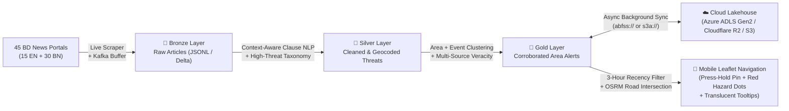

# BigWarn: Cloud Medallion Lakehouse, Context-Aware Threat NLP & Leaflet Road Navigation Guide

**Authors:** Asif Zaman (25-93713-1) & Sabiha Khair Ohi (25-93714-1)  
**Course:** MScCS Big Data Technologies [A] — AIUB  
**Version:** 2.1 (Cloud Lakehouse & Real-Road Navigation Edition)

---

## 1. Overview of the Implemented System

BigWarn ingests real-time news across **45 Bangladeshi newspapers and online portals** (15 English + 30 Bangla), transforms the raw stream through a **3-Layer Medallion Lakehouse (Bronze $\rightarrow$ Silver $\rightarrow$ Gold)** with asynchronous **Cloud Lakehouse synchronization**, and delivers route-filtered hazard alerts to an interactive **Leaflet + OpenStreetMap Mobile Navigation App**.



---

## 2. Medallion Lakehouse Architecture & Cloud Sync

### 2.1 Physical Storage & Table Layers (`backend/lakehouse/elt/medallion_manager.py`)

| Medallion Layer | Local Storage Path | Cloud Partition Key | Responsibility |
| :--- | :--- | :--- | :--- |
| **🥉 Bronze (Raw)** | `backend/lakehouse/storage/bronze/articles/bronze_articles_<date>.jsonl` | `bronze/date=<YYYY-MM-DD>/bronze_articles_<date>.jsonl` | Immutable append archive of all scraped articles with full HTML body, raw timestamps, and source metadata. |
| **🥈 Silver (Cleaned)** | `backend/lakehouse/storage/silver/disruptions/silver_disruptions_<date>.jsonl` | `silver/date=<YYYY-MM-DD>/silver_disruptions_<date>.jsonl` | Filtered strictly for active public safety threats, deduplicated, normalized to Dhaka time (`UTC+6`), and geocoded to OpenStreetMap `(lat, lon)` centroids. |
| **🥇 Gold (Curated)** | `backend/lakehouse/storage/gold/area_alerts/gold_alerts_<date>.json` | `gold/date=<YYYY-MM-DD>/gold_alerts_<date>.json` | Clustered by `(date, area, event_type)`, sorted newest-first, with multi-source credibility scores ($45\% \rightarrow 99\%$) and `is_recent_3h` recency flags. |

### 2.2 Multi-Cloud Lakehouse Connector (`backend/lakehouse/elt/cloud_lakehouse.py`)

The backend uses a **Hybrid Cloud + Local Edge Cache** pattern:
- Mobile API requests (`/api/v1/alerts/route`) are served in `< 5 ms` from the local cache.
- Every time the Medallion layers materialize, `CloudLakehouseConnector.sync_medallion_files_async()` pushes the Bronze, Silver, and Gold partitions to your configured Cloud Lakehouse in a non-blocking background thread.
- PySpark (`backend/streaming/spark/elt_jobs.py`) automatically configures `abfss://` (Azure ADLS Gen2) or `s3a://` (Cloudflare R2 / AWS S3) drivers when credentials are set in `backend/.env`.

#### Option A: Microsoft Azure Data Lake Storage Gen2 (Free with AIUB Student Email)
Copy `backend/.env.example` to `backend/.env` and configure:
```env
BIGWARN_CLOUD_PROVIDER=azure_adls
# Zero-SDK Container SAS URL from Azure Portal -> Storage Account -> Containers -> bigwarn-lakehouse -> Generate SAS:
AZURE_STORAGE_SAS_URL="https://<your-account>.blob.core.windows.net/bigwarn-lakehouse?sp=racwdl&st=..."

# Optional Account Key for PySpark abfss:// streaming:
AZURE_STORAGE_ACCOUNT=<your-account>
AZURE_STORAGE_KEY=<your-key>
AZURE_LAKEHOUSE_CONTAINER=bigwarn-lakehouse
```

#### Option B: Cloudflare R2 / AWS S3 (10 GB/Month Free Forever)
```env
BIGWARN_CLOUD_PROVIDER=cloudflare_r2
S3_ENDPOINT_URL=https://<account_id>.r2.cloudflarestorage.com
S3_LAKEHOUSE_BUCKET=bigwarn-lakehouse
AWS_ACCESS_KEY_ID=<your_key_id>
AWS_SECRET_ACCESS_KEY=<your_secret_key>
```

---

## 3. Context-Aware Bilingual Threat & Location NLP (`backend/ingestion/enrichment/taxonomy.py`)

### 3.1 High-Threat Public Safety Event Taxonomy
To prevent normal routine events from polluting the map, `EVENT_TAXONOMY` filters strictly for active public safety threats:
1. **`gunfire` (Firing / Shooting / Bomb & Cocktail Blast):** `গুলিবর্ষণ`, `গোলাগুলি`, `গুলিবিদ্ধ`, `বন্দুকযুদ্ধ`, `ফায়ারিং`, `ককটেল বিস্ফোরণ`, `ককটেল নিক্ষেপ`, `বোমা বিস্ফোরণ`, `পেট্রলবোমা`, `গ্রেনেড হামলা`, `gunfire`, `shooting`, `shot dead`, `open fire`, `crude bomb`, `cocktail bomb`, `bomb blast`.
   - *Bengali Morphology Guard:* Uses negative lookbehind `(?<![ঁ-৯অ-হ])` before `গুলি` so Bengali plural suffixes (e.g., `ঘরগুলি`, `দোকানগুলি`) never false-trigger gunfire.
2. **`murder` (Murder / Homicide / Stabbing / Lynching / Kidnapping):** `হত্যাকাণ্ড`, `কুপিয়ে হত্যা`, `পিটিয়ে হত্যা`, `গণপিটুনি`, `গলাকেটে হত্যা`, `ছুরিকাঘাত`, `লাশ উদ্ধার`, `মরদেহ উদ্ধার`, `সশস্ত্র হামলা`, `ডাকাতি`, `অপহরণ`, `murder`, `homicide`, `hacked to death`, `stabbed`, `lynched`, `dead body recovered`.
3. **`fire` (Arson / Vehicle Fire / Severe Blaze):** `বাসে আগুন`, `গাড়িতে আগুন`, `অগ্নিসংযোগ`, `ভয়াবহ আগুন`, `অগ্নিকাণ্ড`, `বস্তিতে আগুন`, `set on fire`, `set ablaze`, `torched`, `arson`, `slum blaze`.
4. **`clash` (Violent Clash / Tear Gas / Vandalism):** `সংঘর্ষ`, `ধাওয়া-পাল্টা ধাওয়া`, `ইটপাটকেল`, `টিয়ারশেল`, `সাউন্ড গ্রেনেড`, `ভাঙচুর`, `লাঠিচার্জ`, `রণক্ষেত্র`.
5. **`blockade` & `strike` (Road/Rail Blockades & Hartals):** `সড়ক অবরোধ`, `মহাসড়ক অবরোধ`, `যান চলাচল বন্ধ`, `হরতাল`, `পরিবহন ধর্মঘট`, `ঘেরাও`.
6. **`accident`, `waterlogging`, `power_outage`:** Fatal collisions, submerged streets, and national grid failures.

### 3.2 Solving Cross-Location Pollution (Why Banani Bus Fires Never Leak into Jatrabari)
Previously, multi-incident roundup articles (e.g., *"Four buses torched in Rampura, Badda, Pallabi and Mohakhali, while crude bombs were hurled in Mohammadpur and Jatrabari"*) took the Cartesian product `locations × event_types`, falsely assigning `fire` to `Jatrabari`.

Our upgraded spatial NLP pipeline eliminates this via four rules:
1. **Headline Location Authority:** If the headline explicitly names location(s) (e.g., *"মহাখালীতে স্টাফ বাসে আগুন"* or *"বনানীতে পুলিশ বক্সে পেট্রলবোমা"*), the event is locked strictly to the headline location(s).
2. **Clause-Level `(Location -> Event)` Co-occurrence:** For roundup articles, the text is split into clauses (`while`, `meanwhile`, `অন্যদিকে`, `এছাড়া`, sentence breaks). Each location is bound **only** to the threat event occurring in its own clause (`Mohakhali -> fire`, `Jatrabari -> gunfire`).
3. **Police Title, Bus Route & Footer Stripping:** Automatically strips officer attribution (`বনানী থানার ওসি`, `AC of Gulshan zone`), bus-route origin/destination modifiers (`যাত্রাবাড়ীগামী বাস`, `travelling from Gulshan`), inline "Read More" links (`আরও পড়ুন`), and newspaper office footers (`House-1/B, Road-35, Gulshan-2`).
4. **Outside-Dhaka Provincial Headline Guard:** Headlines anchored in provincial towns (`ভাঙ্গায়...`, `ডুমুরিয়ায়...`, `সাঁথিয়ায়...`) are prevented from leaking into Dhaka neighborhoods.

---

## 4. Mobile Leaflet Navigation UI & 3-Hour Recency Filtering

### 4.1 Google Maps-Style Press-and-Hold Pin & Draggable Marker (`mobile/src/components/OsmMapWebView.tsx`)
- **Press & Hold (~420ms)** anywhere on the Leaflet map (or drag the existing pin) to drop a **Google Maps-style Red Teardrop Destination Pin** with haptic feedback.
- Automatically snaps to the nearest neighborhood label (e.g., `Pin near Banani`) and requests the road route.

### 4.2 Real Street Navigation via OSRM (`backend/app/services/route_service.py`)
- Queries the **OSRM Road Routing Engine** (`router.project-osrm.org/route/v1/driving/...`) with an in-memory coordinate cache.
- Renders the **primary minimum road polyline** in Google Maps navigation blue (`#3B82F6` over `#1E3A8A` casing) along actual streets and flyovers, plus dashed alternative road routes and a compact translucent ETA badge (`🚗 6.8 km • 18m`).

### 4.3 3-Hour Recency Window (`<= 180 Minutes`) for Route Red Hazard Dots
- Only active threats published **within the last 3 hours (`age_minutes <= 180`)** generate a red danger road stretch and a **pulsing Red Hazard Dot (`🔴`)** on the navigated route.
- Older reports (`> 3 hours ago`) are automatically excluded from route hazards so the navigation line remains clean.

### 4.4 Click-to-Open Translucent Glass Tooltips & Zero-Flicker Rendering
- Tooltips are **not** permanently open over the road. Instead, each affected road segment displays a clean pulsing red dot (`🔴`).
- Clicking/tapping a red dot opens a **single semi-transparent glassmorphism popup** (`background: rgba(15, 23, 42, 0.62)`, `backdrop-filter: blur(6px)`) so the road remains visible underneath.
- Tapping **`Full News ›`** opens the **Area Detail Drawer** (`mobile/src/components/AreaDetailModal.tsx`), where all articles are sorted **newest-first** with exact publish date, time, and relative age (`18 Nov 2026, 12:35 PM • 18m ago`).
- **Zero-Flicker State Fingerprinting:** Both React Native (`lastPollSigRef` in `mobile/App.tsx`) and the Leaflet WebView (`lastUserSig`, `lastDestSig`, `lastRouteSig`, `lastMarkersSig`) diff incoming poll payloads so background 8-second refreshes never clear or flicker the map layers.
