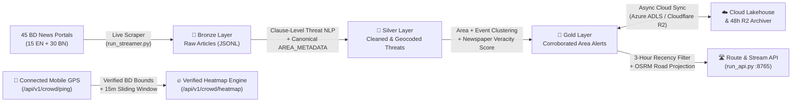

# Backend Architecture, Medallion Lakehouse ELT & Verified Telemetry Guide

This document covers the internal architecture of the **BigWarn Backend** (`real-time-alert/backend/`): the 45-portal bilingual news scraper, the 3-layer Medallion Lakehouse (`Bronze` $\rightarrow$ `Silver` $\rightarrow$ `Gold`), strict canonical Bangladesh spatial NLP, OSRM road-corridor routing, verified crowd telemetry, and REST/SSE APIs.

---

## 1. End-to-End Backend Data Flow

---

## 2. Medallion Lakehouse ELT ([medallion_manager.py](file:///Users/sabihakhairohi/Projects/news-alert/real-time-alert/backend/lakehouse/elt/medallion_manager.py))

All three Medallion layers are materialized under `backend/lakehouse/storage/` and cached in memory for `< 5 ms` API response times:

| Layer | Storage Path | Description |
| :--- | :--- | :--- |
| **🥉 Bronze** | `storage/bronze/articles/bronze_articles_<YYYY-MM-DD>.jsonl` | Immutable raw articles scraped from 45 Bangladesh portals with source, language (`bn`/`en`), headline, full body, and timestamps. |
| **🥈 Silver** | `storage/silver/disruptions/silver_disruptions_<YYYY-MM-DD>.jsonl` | Filtered strictly for active public safety disruptions, deduplicated by normalized headline, normalized to Dhaka time (`UTC+6`), and geocoded to canonical `(lat, lon, city)` coordinates. |
| **🥇 Gold** | `storage/gold/area_alerts/gold_alerts_<YYYY-MM-DD>.json` | Clustered by `(date, area, event_type)`, sorted newest-first, with `age_minutes`, `is_recent_3h` (`age_minutes <= 180`), newspaper veracity scores, and verified crowd metrics. |

### Newspaper-Based Veracity & Credibility Formula
Credibility is computed strictly from independent newspaper/portal corroboration:

$$\text{credibility\_score} = \min\left(0.99,\; 0.45 + 0.18 \times N_{\text{sources}} + (0.08 \text{ if bilingual})\right)$$

- **`VERIFIED (Multi-Source)` (`HIGH`)**: $\ge 3$ independent newspapers/portals
- **`CONFIRMED` (`MEDIUM`)**: $2$ independent newspapers/portals
- **`UNCONFIRMED (Single Source)` (`LOW`)**: $1$ newspaper/portal

---

## 3. Bilingual Threat & Strict Canonical Bangladesh Location NLP ([taxonomy.py](file:///Users/sabihakhairohi/Projects/news-alert/real-time-alert/backend/ingestion/enrichment/taxonomy.py))

1. **Strict Canonical Location Dictionary (`AREA_METADATA`, `TAG_VERSION = 3`)**:
   - Every valid location must exist in `AREA_METADATA`, which covers **all 64 districts of Bangladesh**, major national highway hubs (`Savar`, `Ashulia`, `Tongi`, `Gazipur`, `Narayanganj`), and **all Dhaka metropolitan neighborhoods** (`Mirpur-10`, `Mirpur-1`, `Mirpur-2`, `Mirpur-11`, `Mirpur-12`, `Pallabi`, `Kalshi`, `Kazipara`, `Shewrapara`, `Agargaon`, `Bijoy Sarani`, `Farmgate`, `Karwan Bazar`, `Banglamotor`, `Shahbagh`, `Paltan`, `Motijheel`, `Gulistan`, `Jatrabari`, `Sayedabad`, `Dhanmondi`, `Science Lab`, `New Market`, `Mohammadpur`, `Gabtoli`, `Tejgaon`, `Mohakhali`, `Banani`, `Gulshan`, `Badda`, `Rampura`, `Malibagh`, `Moghbazar`, `Kuril`, `Airport`, `Uttara`, `Abdullahpur`, `Sadarghat`, `Old Dhaka`, etc.).
   - Famous squares and landmarks are mapped directly to their canonical area (e.g., `শাপলা চত্বর` / `Shapla Chattar` $\rightarrow$ `Motijheel`; `দোয়েল চত্বর` $\rightarrow$ `Shahbagh`; `ইসিবি চত্বর` $\rightarrow$ `Kalshi`; `৩০০ ফিট` / `পূর্বাচল` $\rightarrow$ `Kuril`).
   - Open-vocabulary regex guessing (`_find_dynamic_locations`) is disabled so random Bangla words (`shapla`, `poro`, `carbon`, etc.) can never leak onto the map as fake places.
2. **Clause-Level `(Location -> Event)` Binding**:
   - Multi-incident roundup articles are split into clauses (`CLAUSE_SPLIT_RE`) so each location is bound only to the threat occurring in its own clause.
   - Police titles (`বনানী থানার ওসি`), bus-route modifiers (`যাত্রাবাড়ীগামী বাস`), and newspaper office address footers are stripped prior to spatial matching.

---

## 4. OSRM Real-Road Routing & 3-Hour Recency Filter ([route_service.py](file:///Users/sabihakhairohi/Projects/news-alert/real-time-alert/backend/app/services/route_service.py))

- Queries `https://router.project-osrm.org/route/v1/driving/` to retrieve the actual street geometry (`polyline`), alternative route (`alt_polyline`), distance (`km`), duration (`min`), and road names.
- **Strict 3-Hour Recency Filter (`is_recent_3h`)**:
  - Alerts older than 3 hours (`age_minutes > 180`) are skipped during route hazard evaluation.
- **Exact Perpendicular Point-to-Segment Projection**:
  - Each recent (`<= 3h`) alert within `1.35 km` of the route is projected perpendicularly onto the closest road polyline segment (`road_snap_lat`, `road_snap_lon`), producing `danger_segments` with `tooltip_lat` and `tooltip_lon` right on the road.

---

## 5. Verified Crowd-Sourcing & Heatmap Service ([crowd_service.py](file:///Users/sabihakhairohi/Projects/news-alert/real-time-alert/backend/app/services/crowd_service.py))

- **Zero Synthetic Sine-Wave Data**: All mathematical sine-wave generators have been removed.
- **Hardware GPS Ping Verification (`record_verified_ping`)**:
  - Validates that incoming `/api/v1/crowd/ping` coordinates lie inside Bangladesh (`20.50°N–26.70°N`, `88.00°E–92.80°E`), have valid velocity (`0–160 km/h`) and GPS accuracy (`<= 1000m`), and snap within `18 km` to a canonical `AREA_METADATA` location.
  - Persists active verified device pings in `backend/lakehouse/storage/gold/verified_crowd_pings.json` over a **15-minute sliding window (`900s` TTL)**.
  - Classifies real devices with `speed_kmh < 5.0` as **Stuck** and `speed_kmh >= 5.0` as **Moving**.
- **Verified Multi-Source Disruption Heatmaps (`get_all_bangladesh_heatmaps`)**:
  - Combines verified live hardware GPS pings with corroborated Gold alerts from the 45-portal Lakehouse (`source_count`, `article_count`, `sources`).

---

## 6. REST & SSE Stream API Endpoints ([server.py](file:///Users/sabihakhairohi/Projects/news-alert/real-time-alert/backend/app/api/server.py))

| Endpoint | Method | Description |
| :--- | :--- | :--- |
| `/api/v1/health` | `GET` | Service health check (`status: "ok"`). |
| `/api/v1/alerts/route` | `GET` | Computes OSRM road route, 3-hour route hazards (`danger_segments`), risk level, and optional `include_map=1` Gold alerts. |
| `/api/v1/alerts/map` | `GET` | Returns all active Gold alert clusters (`?city=ALL` or specific city). |
| `/api/v1/crowd/ping` | `GET` / `POST` | Validates and records a real hardware GPS telemetry ping (`device_id`, `lat`, `lon`, `speed_kmh`, `accuracy_m`). |
| `/api/v1/crowd/heatmap` | `GET` | Returns all verified active heatmap zones across Bangladesh. |
| `/api/v1/lakehouse` | `GET` | Returns full Bronze, Silver, and Gold Medallion stats and tables. |
| `/api/v1/sources` | `GET` | Returns metadata for all 45 configured Bangladesh news portals. |
| `/api/v1/stream/feed` | `GET` | Unified open public feed (`?layer=gold|silver|bronze&format=json|ndjson|sse|rss`). |
| `/api/v1/archive/status` | `GET` | Returns 48-hour Cloudflare R2 archival status. |
