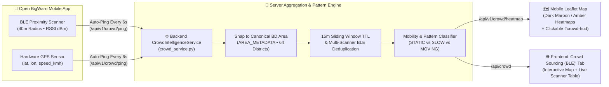
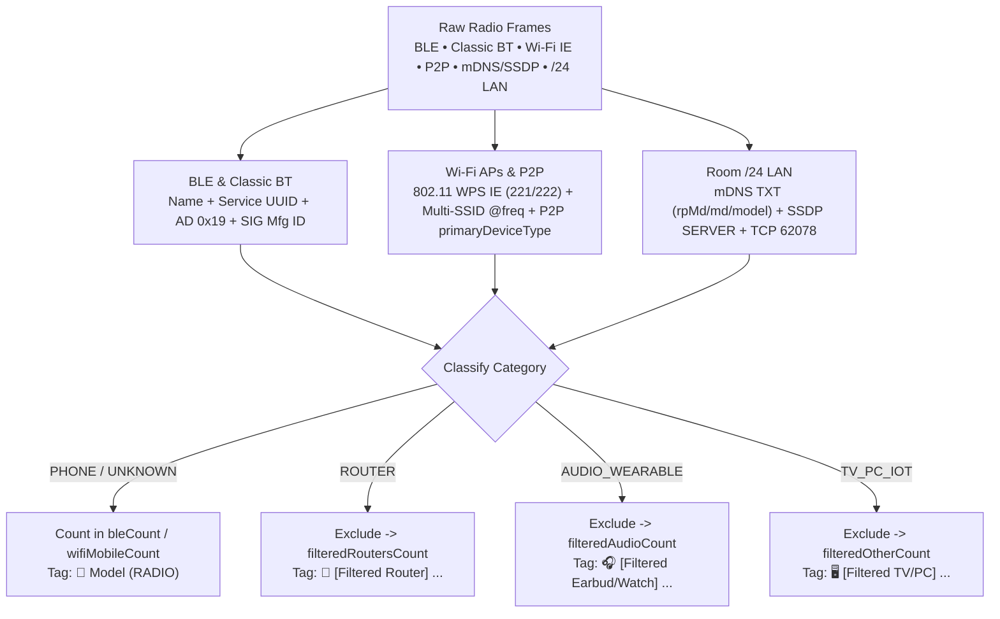

# 📡 Multi-Radio Proximity Crowd-Sourcing (BLE + Wi-Fi [BT Off] + 4G Cell Load) & Live Mobility Heatmap Guide

This document explains how **BigWarn** detects real-time crowd size, static vs. moving crowd behavior, and spatial congestion patterns across Bangladesh using **4-Radio Hardware Sensing (Passive BLE + Wi-Fi Mobile Peers with Bluetooth OFF + 4G/LTE Cell Tower Load + Hardware GPS Velocity)**, and how this data is visualized on both the **Mobile App Map** and the **Frontend Web Console (`📡 Crowd Sourcing (BLE)`)**.

> [!TIP]
> For the complete Single-Phone Multi-Radio Surroundings & Traffic Detection architecture and mathematical formulas, see [04_MULTI_RADIO_CROWD_AND_TRAFFIC_DETECTION_PLAN.md](file:///Users/sabihakhairohi/Projects/news-alert/real-time-alert/docs_vault/mobile/04_MULTI_RADIO_CROWD_AND_TRAFFIC_DETECTION_PLAN.md).

---

## 1. Core Concept: How 1 Opened App Phone Measures Surroundings Even When Others Have Bluetooth OFF

A single smartphone's GPS sensor only knows the location and speed of that **1 phone**. To measure the surrounding crowd and traffic with **only 1 or 2 opened BigWarn phones**—even when people around them have **not downloaded the app** and have **Bluetooth turned OFF**—BigWarn fuses **4 independent hardware radios** in [BigWarnBleScannerModule.kt](file:///Users/sabihakhairohi/Projects/news-alert/real-time-alert/mobile/plugins/android/BigWarnBleScannerModule.kt):

1. **Radio A — Bluetooth Low Energy + Classic BT (`BluetoothLeScanner` / `BluetoothDevice.ACTION_FOUND`)**:
   - Passively scans nearby BLE advertisements (`>= -98 dBm`) and runs periodic 7 s Classic Bluetooth discovery inquiries every 55 s, then classifies peers (`PHONE` vs. `AUDIO_WEARABLE` vs. `TV_PC_IOT`) so earbuds, headphones, smartwatches, and PCs are **filtered out** of phone counts (`ble_count`).
2. **Radio B — Wi-Fi Mobile Peer, Hotspot & Room LAN Scanner (`WifiManager` / `WifiP2pManager` / `NsdManager`, 50m radius — Detects Phones with Bluetooth OFF)**:
   - Passively detects nearby smartphones that have **Bluetooth turned OFF** via mobile hotspots, Wi-Fi Direct (`WifiP2pManager`), and shared `/24` LAN subnet discovery (`mDNS` + `ICMP` + Apple TCP `62078`).
   - Uses 802.11 WPS Vendor Information Elements (`id=221/222`), Multi-SSID shared router MAC/frequency matching (`bssid.substring(3, 14)@freq`), `SSDP M-SEARCH`, and mDNS TXT tags to **filter out fixed routers, Guest VAPs, Smart TVs, and printers** (`filtered_routers_count`, `filtered_other_count`) from phone counts (`wifi_mobile_count`).
3. **Radio C — 4G/LTE/5G Cellular Tower Congestion (`TelephonyManager.getAllCellInfo()`)**:
   - Reads the serving cell tower's **RSRP (`dBm`)** and **RSRQ (`dB`, `-3` to `-20 dB`)** to compute **`cell_load_percent` (`0–100%`)**.
   - Even if surrounding phones have **both Bluetooth and Wi-Fi turned OFF**, every phone with a SIM card connects to the local 4G cell tower—causing `RSRQ` to drop from `-6 dB` (empty road) to `-16 dB+` (`75–100%` load) during a strike or traffic blockade.
4. **Radio D — Hardware GPS Velocity (`expo-location`, `speed_kmh`)**:
   - Measures the scanner phone's real ground speed (`km/h`) and combines it with BLE/Wi-Fi RSSI stability ($\Delta\text{RSSI} \le 6\text{ dBm}$) to classify how many surrounding devices are **STATIC / STUCK (`< 3.5 km/h`)** vs. **MOVING (`>= 3.5 km/h`)**.

---

## 2. End-to-End Architecture & Data Flow

---

## 3. Step-by-Step Technical Breakdown

### 3.1 Expo Config Plugin & Native Android 4-Radio Scanner ([withBigWarnMultiRadio.js](file:///Users/sabihakhairohi/Projects/news-alert/real-time-alert/mobile/plugins/withBigWarnMultiRadio.js) & [bleCrowdScanner.ts](file:///Users/sabihakhairohi/Projects/news-alert/real-time-alert/mobile/src/services/bleCrowdScanner.ts))

1. **Persistent Native Sources via Expo Config Plugin (`mobile/plugins/withBigWarnMultiRadio.js`)**:
   - Because `mobile/android/` is gitignored and `npx expo prebuild --platform android` regenerates `MainApplication.kt` and `AndroidManifest.xml`, the Kotlin native scanner sources are kept cleanly in [BigWarnBleScannerModule.kt](file:///Users/sabihakhairohi/Projects/news-alert/real-time-alert/mobile/plugins/android/BigWarnBleScannerModule.kt) and [BigWarnBleScannerPackage.kt](file:///Users/sabihakhairohi/Projects/news-alert/real-time-alert/mobile/plugins/android/BigWarnBleScannerPackage.kt), and copied into `android/app/src/main/java/com/bigwarn/edge/` during prebuild by [withBigWarnMultiRadio.js](file:///Users/sabihakhairohi/Projects/news-alert/real-time-alert/mobile/plugins/withBigWarnMultiRadio.js) (registered in [app.json](file:///Users/sabihakhairohi/Projects/news-alert/real-time-alert/mobile/app.json)).
   - On every `npx expo prebuild`, it registers `add(BigWarnBleScannerPackage())` in `MainApplication.kt`, injects Android 12–16 permissions (`BLUETOOTH_SCAN`, `BLUETOOTH_CONNECT`, `BLUETOOTH_ADVERTISE`, `NEARBY_WIFI_DEVICES`, `ACCESS_FINE_LOCATION`, `ACCESS_WIFI_STATE`, `CHANGE_WIFI_STATE`, `ACCESS_NETWORK_STATE`), and adds R8/ProGuard keep rules in `proguard-rules.pro`.
2. **Radio A — BLE Scan (`>= -98 dBm`) + BigWarn Beacon Advertiser + Classic BT (`BluetoothLeScanner` / `BluetoothLeAdvertiser`)**:
   - Uses `SCAN_MODE_LOW_LATENCY`, `MATCH_MODE_AGGRESSIVE`, `CALLBACK_TYPE_ALL_MATCHES` + periodic 7 s Classic Bluetooth (`ACTION_FOUND`) discovery every 55 s (`60 s` TTL) + BigWarn BLE service UUID (`0000b19a-...`) advertising so nearby BigWarn devices detect each other even offline.
3. **Radio B — Wi-Fi 3-Layer Detection (`wifi_mobile_count = hotspot + p2p + lan`, `95 s` TTL)**:
   - **Hotspots & Mobile APs (`WifiManager.startScan()`, `>= -88 dBm`)**: Detects nearby phones with Hotspot ON via mobile SSIDs and Locally-Administered MACs (`2, 6, A, E`) while isolating fixed & Guest routers.
   - **Wi-Fi Direct (`WifiP2pManager.discoverPeers()`)**: Discovers nearby Android peers with Wi-Fi ON even without sharing a router.
   - **Shared `/24` Room/Bus Wi-Fi LAN (`NsdManager` mDNS + `SSDP` + subnet reachability)**: When connected to a `/24` Wi-Fi router, discovers live sibling phones sharing the same subnet—**even iPhones or idle Androids with screen off and Bluetooth off**—excluding self and default gateway IP.
4. **Radio C — Cellular Congestion (`TelephonyManager.requestCellInfoUpdate` + `allCellInfo`)**:
   - Refreshes real serving/neighbor **4G LTE**, **5G NR**, **3G WCDMA**, and **2G GSM** signal strength (`rsrp`, `rsrq`, `rssnr`, `cqi`, `dbm`) across available cells to compute `cell_load_percent` (`5–100%`) and `cell_tower_count`.
5. **Indoor/Outdoor Location & Silent Multi-Radio Background Sensing ([mobile/App.tsx](file:///Users/sabihakhairohi/Projects/news-alert/real-time-alert/mobile/App.tsx))**:
   - Uses `getLastKnownPositionAsync` + `Accuracy.Balanced` + continuous `watchPositionAsync` (with 6 s retry) so pings work indoors immediately without waiting for outdoor GPS lock.
   - Runs silently in the background without cluttering the map screen; crowd telemetry is shown on heatmap tap (`#crowd-hud`) and in full detail on the Web Frontend Live Table.

---

### 3.2 Surrounding Device Model Extraction & Non-Phone Noise Filtering ([BigWarnBleScannerModule.kt](file:///Users/sabihakhairohi/Projects/news-alert/real-time-alert/mobile/plugins/android/BigWarnBleScannerModule.kt))

Surrounding radios advertise non-human hardware such as Wi-Fi routers, Guest SSIDs, TWS earbuds, smartwatches, Smart TVs, printers, and PCs alongside actual smartphones. Every peer discovered across BLE, Classic BT, Wi-Fi Scan, Wi-Fi Direct, and LAN is run through a **5-category classification pipeline** (`PHONE`, `ROUTER`, `AUDIO_WEARABLE`, `TV_PC_IOT`, `UNKNOWN`) before counting:

#### Signal-by-Signal Model Extraction Rules

| Radio Layer | Extracted Signals & Identifiers | How Category & Model Name Are Derived |
| :--- | :--- | :--- |
| **BLE (`classifyBleScanResult`)** | 1. **`scanRecord.deviceName`** 2. **GATT Service UUIDs** 3. **GAP Appearance (`AD 0x19`)** 4. **`BluetoothClass.Device.Major`** 5. **Manufacturer Data (`SIG Company ID`)** | • Name regex checks audio (`AirPods`, `TWS`, `Galaxy Buds`, `Oraimo`, `JBL`, `Watch`, `Mi Band`), TV/PC (`Bravia`, `WebOS`, `DESKTOP-`, `MacBook`), then phones (`iPhone`, `Galaxy`, `Redmi`, `POCO`, `vivo`, `OPPO`, `Realme`, `OnePlus`, `Pixel`, etc.). • **Service UUIDs**: `0000B19A` → `BigWarn App Phone`; `0000180D` / `0000FEE0` / `0000110B` / `0000184E` → `AUDIO_WEARABLE`. • **AD Type `0x19` (`appearance shr 6`)**: `1` → `PHONE` (`Smartphone`); `3`/`33`/`34`/`40` → `AUDIO_WEARABLE`; `2`/`15` → `TV_PC_IOT`. • **Manufacturer IDs**: &nbsp;&nbsp;- `0x004C` (Apple Continuity `subType` byte): `0x07` → `AUDIO_WEARABLE` (`Apple AirPods / Beats`), `0x09`/`0x0A` → `TV_PC_IOT` (`Apple TV / HomePod`), `0x12` → `AUDIO_WEARABLE` (`FindMy Tag / Accessory`), other subTypes → `PHONE` (`Apple iPhone` or advertised name). &nbsp;&nbsp;- `0x0006` → `TV_PC_IOT` (`Windows PC (Swift Pair)`). &nbsp;&nbsp;- `0x0157` → `AUDIO_WEARABLE` (`Amazfit / Huami Watch`). &nbsp;&nbsp;- `0x0075` (`Samsung Galaxy`), `0x038F` (`Xiaomi / Redmi`), `0x0837` (`vivo Phone`), `0x079A`/`0x009E` (`OPPO / Realme / OnePlus`), `0x00E0` (`Android Phone (Google)`) → `PHONE`. |
| **Classic Bluetooth (`classifyClassicBluetooth`)** | `BluetoothDevice.ACTION_FOUND` name + `bluetoothClass.majorDeviceClass` | • `AUDIO_VIDEO` / `WEARABLE` → `AUDIO_WEARABLE`. • `COMPUTER` / `IMAGING` → `TV_PC_IOT`. • `PHONE` or mobile name match → `PHONE`. |
| **Wi-Fi APs & Hotspots (`refreshWifiApResults`)** | 1. **802.11 WPS/Vendor IEs** (`ie.id == 221` or `222`, Android R+) 2. **SSID keywords** (`routerApRegex` vs. `phoneModelRegex`) 3. **BSSID OUI vs. LAA bit** 4. **Multi-SSID signature** (`bssid.substring(3, 14) + "@" + sr.frequency`) | • **Two-pass virtual Guest AP detection**: Pass 1 fingerprints every fixed OUI router, WPS vendor match (`TP-Link`, `Archer`, `Tenda`, `Mercusys`, `D-Link`, `Netis`, `MikroTik`, `Ubiquiti`, `HUAWEI-`/`HG`/`EG`, `ZTE_`/`ZXHN`, `FiberHome`, `ONT`/`ONU`), or router SSID (`_5G`, `_2.4G`, `Guest`, `Extender`) by its middle 4 BSSID octets + channel frequency. • Pass 2 catches randomized/LAA Virtual Guest SSIDs emitted by the same physical router and routes them to `ROUTER` (`📡 SSID [Vendor]` → `filteredRoutersCount`), leaving only true phone hotspots in `wifiHotspotCount`. |
| **Wi-Fi Direct (`requestP2pPeersSafe`)** | `WifiP2pDevice.deviceName` + `primaryDeviceType` | • `primaryDeviceType` starting with `7-` (Displays) or `1-` (Computers, unless `phoneModelRegex` matches) or `tvComputerIotRegex` → `TV_PC_IOT`. • `3-` (Network infra) → `ROUTER`. • Otherwise counted as `PHONE` (`WIFI_P2P`) using `deviceName` or `Android Phone (P2P)`. |
| **Room `/24` LAN (`NsdManager`, `SSDP`, TCP `62078`)** | 1. **mDNS TXT attributes** (`rpMd`, `md`, `model`) across `_companion-link._tcp.`, `_googlecast._tcp.`, `_airplay._tcp.`, `_ipp._tcp.` 2. **SSDP `M-SEARCH` (`239.255.255.250:1900`)** `SERVER:` banner 3. **ICMP reachability + Apple port `62078`** | • `_googlecast`, `_ipp`, Smart TV (`Bravia`, `WebOS`, `Tizen`), printer/scanner, MacBook, or SSDP router/gateway responses mark `lanFilteredIps[ip]` as `ROUTER` or `TV_PC_IOT` so live sweep hosts exclude them. • `_companion-link` or `iphone` resolves as `PHONE`. • During the `/24` sweep (excluding self and gateway IP), a reachable host responding on TCP `62078` (`lockdownd`) is labeled **`Apple iPhone (LAN)`** (`PHONE`); other non-filtered live hosts are labeled **`Room Phone (Wi-Fi LAN)`**. |

#### Aggregation, Output Format & Privacy
- **Strict Separation of Counts**: Only `PHONE` (and `UNKNOWN` BT/P2P/LAN peers not matched as noise) increment `bleCount` or `wifiMobileCount`. Confirmed `ROUTER`, `AUDIO_WEARABLE`, and `TV_PC_IOT` are excluded into `filteredRoutersCount` (`wifiFixedApCount`), `filteredAudioCount`, and `filteredOtherCount`.
- **Anonymized `detectedModels` Array**: Up to `24` unique formatted labels per snapshot are emitted with prefixes (`📱 `, `📡 [Filtered Router] `, `🎧 [Filtered Earbud/Watch] `, `🖥️ [Filtered TV/PC] `) and radio source suffix (`(BLE)`, `(BT_CLASSIC)`, `(WIFI_HOTSPOT)`, `(WIFI_AP)`, `(WIFI_P2P)`, `(WIFI_LAN)`). **Raw BSSIDs, Bluetooth MACs, and local IP addresses never leave the device.**
- **Where Displayed**: Extracted model names are **hidden inside the Mobile App map HUD** (`OsmMapWebView.tsx` shows only radio metrics + numeric `Filtered noise: ...` counts) and **rendered in full on the Frontend Web Console** (`Detected Devices & Filtered Noise` column and mobile cards in `ble-crowd-dashboard.tsx`).

---

### 3.3 Backend Aggregation, Deduplication & Mobility Pattern Classifier ([backend/app/services/crowd_service.py](file:///Users/sabihakhairohi/Projects/news-alert/real-time-alert/backend/app/services/crowd_service.py))

When `/api/v1/crowd/ping` receives a scan from an open app user:

1. **Bangladesh Geofence Verification & Area Snapping**:
   - Validates that `20.50°N <= lat <= 26.70°N` and `88.00°E <= lon <= 92.80°E`.
   - Uses Haversine distance (`snap_to_bangladesh_area`) to snap the coordinates to the nearest canonical Bangladesh neighborhood or district in `AREA_METADATA`.
2. **Strict 30-Second Live Session TTL (No Ghost Rows)**:
   - An opened app pings every `6 seconds`, so `PING_TTL_SECONDS = 30`. Any session that has not pinged in the last `30 seconds` (app closed, backgrounded, or reloaded) is pruned immediately from the live table and heatmaps.
3. **Legacy Synthetic Ping Rejection**:
   - Pings tagged with the old synthetic `network_type: "BLE_5.0 + 4G"` (sent by outdated cached app bundles) have their `ble_count` forced to `0` on ingest, and any such stored records are filtered out on load, so fabricated numbers (e.g., `+38 BLE` / `+41 BLE`) can never appear.
4. **50-Meter Cross-Detection & Multi-Radio Summation**:
   - For each opened app user, the server also counts any **other opened BigWarn phones within `50 m`** (Haversine). Two phones opened side-by-side detect each other as `+1` peer each.
   - Effective BLE peers:
   $$\text{ble\_count} = \max\left(\text{hardware BLE peers},\ \text{nearby opened app phones within 50 m}\right)$$
5. **Crowd Around Opened App User (`total_crowd_around_me`)**:
   $$\text{total\_crowd\_around\_me} = 1\text{ (this opened app phone)} + \text{ble\_count} + \text{wifi\_mobile\_count}$$
   - Example: 1 phone, no surrounding phones → `1` (`+0 BLE`). 2 phones opened together → each shows `2` (`+1`).
6. **Spatial Density per $100\text{ m}^2$**:
   With a scan radius $r = 50\text{ m}$ ($\text{Area} = \pi r^2 \approx 7,854.0\text{ m}^2$):
   $$\text{density\_per\_100m2} = \frac{\text{total\_crowd\_around\_me}}{\pi r^2} \times 100$$
7. **Area Heatmap Aggregation (Overlap-Safe)**:
   Phones in the same area hear largely the same BLE/Wi-Fi peers, so peer counts are not summed across scanners. The area crowd is the number of opened app phones plus the largest single BLE and Wi-Fi mobile phone scans in that area:
   $$\text{total\_mobiles} = N_{\text{opened apps}} + \max_{i}\left(\text{raw\_ble\_count}_i\right) + \max_{i}\left(\text{wifi\_mobile\_count}_i\right)$$
8. **Mobility State & Crowd Pattern Classification (`classify_crowd_pattern`)**:

| Mobility State | Trigger Condition | Crowd Pattern Classification (Based on Peak Threshold) | Heatmap Color |
| :--- | :--- | :--- | :--- |
| **`🔴 STATIC`** | `static_percent >= 68%` **or** `speed_kmh < 3.5 km/h` | • **Very Dense ($\ge 1.45\times$ peak)**: *"Dense Static Gathering / Standstill Blockade"* • **Dense ($\ge 1.0\times$ peak)**: *"High-Density Static Crowd / Bottleneck"* • **Moderate ($\ge 15$ devices)**: *"Stationary Commuter Cluster / Queue"* • **Light ($< 15$ devices)**: *"Localized Static Presence"* | **Dark Crimson / Deep Maroon** (`#7F1D1D` $\rightarrow$ `#3B0707`) |
| **`🟡 SLOW_MOVING`** | `42% <= static_percent < 68%` **or** `3.5 <= speed_kmh < 10.0 km/h` | • **Dense ($\ge 1.0\times$ peak)**: *"Slow-Moving Crowd Surge / Procession"* • **Moderate**: *"Slow Crawling Traffic Corridor"* | **Warm Amber / Deep Orange** (`#F59E0B` $\rightarrow$ `#EA580C`) |
| **`🟢 MOVING`** | `static_percent < 42%` **and** `speed_kmh >= 10.0 km/h` | • **Dense ($\ge 1.0\times$ peak)**: *"High-Volume Moving Transit Flow"* • **Moderate**: *"Normal Free-Flowing Movement"* | **Emerald / Amber Flow** (`#16A34A` $\rightarrow$ `#F59E0B`) |

---

### 3.4 Mobile Map BLE Heatmap & Clickable HUD ([mobile/src/components/OsmMapWebView.tsx](file:///Users/sabihakhairohi/Projects/news-alert/real-time-alert/mobile/src/components/OsmMapWebView.tsx#L611-L672))

On the mobile map:
- Active crowd zones are rendered on `heatmapLayerGroup` using progressive threshold intensities (**`<20`**: `0.20`, **`20–49`**: `0.40`, **`50–99`**: `0.60`, **`100–149`**: `0.80`, **`150+`**: `1.00`).
- **Tapping any heatmap on the mobile map** opens the floating `#crowd-hud` card at the bottom of the screen showing:
  - **Area Name** (`📡 Mirpur-10`) & **Mobility State Badge** (`🔴 STATIC CROWD` / `🟡 SLOW CROWD` / `🟢 MOVING FLOW`)
  - **Detected Crowd Pattern** & **Scanner Summary** (`scannerCount`, `+BLE`, `+Wi-Fi (P2P: / LAN:)`, `4G_LTE %`, plus numeric **`Filtered noise: X Router, Y Audio/Watch, Z TV/PC`** count — **individual device model names are omitted from the mobile HUD**)
  - **3 Stat Boxes**: **Surrounding (`total_mobiles`)**, **Static / Stuck (`%`)**, and **Moving (`%`)**
  - **Static vs. Moving Progress Bar** and **Avg GPS Speed (`km/h`)**.

---

### 3.5 Frontend Web Console: `📡 Crowd Sourcing (BLE)` Feature Tab ([frontend/src/components/features/crowd/ble-crowd-dashboard.tsx](file:///Users/sabihakhairohi/Projects/news-alert/real-time-alert/frontend/src/components/features/crowd/ble-crowd-dashboard.tsx))

In the Next.js Web Console, clicking the **`📡 Crowd Sourcing (BLE)`** tab (in the top navigation bar on desktop or the bottom thumb-navigation bar on mobile) displays a **read-only live observatory** of active mobile app users (no browser-level pinging):

1. **4 Live Multi-Radio Telemetry KPI Cards**:
   - **📱 Open App Scanners**: Total active mobile app instances currently streaming scans.
   - **📡 Accumulated Crowd**: Total mobile app scanners + filtered surrounding BLE/Wi-Fi phone peers.
   - **🔴 Static / Stuck Crowd**: Count and percentage of stationary devices (`< 3.5 km/h`).
   - **🟢 Moving Crowd Flow**: Count and percentage of moving devices (`>= 3.5 km/h`).
2. **Interactive Bangladesh Crowd Heatmap Map**:
   - Full Leaflet + OpenStreetMap canvas rendering progressive threshold heatmaps (`<20 / 20 / 50 / 100 / 150+`). Clicking any heatmap opens the detailed HUD overlay.
3. **Live Crowd Telemetry Table (*"Crowd Around Opened App User"*) & Mobile Cards**:
   - Displays every active opened app user in real time across 8 columns (`DeviceModelsBreakdown` shared with mobile cards):
     - **Opened App User** (`device_label`, `device_id`, live pulsing indicator)
     - **Location** (`Area`, `City`, `lat°N, lon°E`)
     - **Crowd** (`total_crowd_around_me` vs. `peak_threshold`)
     - **Radio & 4G Load** (`+BLE (Phones)`, `+Wi-Fi (P2P/LAN/HS)`, `cell_network_type % & dBm`, spatial density)
     - **Detected Devices & Filtered Noise** (dedicated wide column splitting **Counted Phones (`N`)** badges from **Filtered Out (`Router • Earbud/Watch • TV/PC`)** badges with full untruncated model names and inline `+N more device(s)` expand toggle)
     - **Static vs. Moving** (exact counts, percentages, and red/green progress bar)
     - **Mobility & Pattern** (`🔴 STATIC / STUCK`, `🟡 SLOW CRAWL`, `🟢 MOVING`, `speed_kmh`, `crowd_pattern`)
     - **Last Ping** (`LIVE now` / age in seconds)
   - Clicking any row in the live table flies the map directly to that user's location and opens their heatmap HUD.

---

## 4. API Endpoints Reference

| Endpoint | Method | Purpose |
| :--- | :--- | :--- |
| `/api/v1/crowd/ping` | `GET` / `POST` | Ingests a live multi-radio proximity scan + GPS velocity ping (`device_id`, `device_label`, `lat`, `lon`, `speed_kmh`, `ble_count`, `bt_classic_count`, `wifi_mobile_count`, `wifi_hotspot_count`, `wifi_p2p_count`, `wifi_lan_count`, `wifi_ap_count`, `filtered_routers_count`, `filtered_audio_count`, `filtered_other_count`, `detected_models`, `cell_rsrp_dbm`, `cell_rsrq_db`, `cell_load_percent`, `cell_network_type`, `avg_rssi_dbm`, `scan_radius_m`). |
| `/api/v1/crowd/heatmap` | `GET` | Returns the live crowd snapshot containing `summary` KPIs, `scanners` (rows for the live table including `detected_models` & `filtered_*` counts), and `heatmaps` (aggregated area zones for the map). |
| `/api/crowd` | `GET` / `POST` | Next.js proxy & local persistence route ([frontend/src/app/api/crowd/route.ts](file:///Users/sabihakhairohi/Projects/news-alert/real-time-alert/frontend/src/app/api/crowd/route.ts)) used by the web console. Drops stale (`> 30s`) and legacy `"BLE_5.0 + 4G"` rows, preserves `detected_models` and `filtered_*` fields locally, and re-applies 50 m cross-detection. |

---

## 5. Troubleshooting: Suspicious Rows in the Live Table

| Symptom | Cause | Fix |
| :--- | :--- | :--- |
| Extra rows with large BLE counts (e.g., `+38 BLE`) and old ages (e.g., `489s ago`) | Sessions from an older app bundle with the synthetic fallback, kept alive by the former 15-minute TTL | Now auto-removed (30 s TTL + legacy-tag rejection). Redeploy the backend with `deploy.sh`. |
| One phone appears as several rows | Older builds generated a random `device_id` on every reload | Now uses a stable hardware-fingerprint ID. Rebuild the APK with `build_apk.sh`. |
| Shows `1` (`+0 BLE`) with people around | Bluetooth off, `BLUETOOTH_SCAN` permission denied, or the app is an Expo Go/Web build without the native module | Enable Bluetooth, grant Nearby Devices permission, and install the APK built from `build_apk.sh`. |
| Two phones together each show `1` | Their GPS fixes are more than 50 m apart, or one of them stopped pinging | Ensure both have a GPS fix and the app is open in the foreground. |
