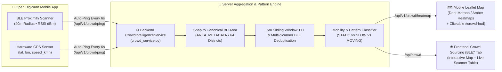

# 📡 Multi-Radio Proximity Crowd-Sourcing (BLE + Wi-Fi [BT Off] + 4G Cell Load) & Live Mobility Heatmap Guide

This document explains how **BigWarn** detects real-time crowd size, static vs. moving crowd behavior, and spatial congestion patterns across Bangladesh using **4-Radio Hardware Sensing (Passive BLE + Wi-Fi Mobile Peers with Bluetooth OFF + 4G/LTE Cell Tower Load + Hardware GPS Velocity)**, and how this data is visualized on both the **Mobile App Map** and the **Frontend Web Console (`📡 Crowd Sourcing (BLE)`)**.

> [!TIP]
> For the complete Single-Phone Multi-Radio Surroundings & Traffic Detection architecture and mathematical formulas, see [04_MULTI_RADIO_CROWD_AND_TRAFFIC_DETECTION_PLAN.md](file:///Users/sabihakhairohi/Projects/news-alert/real-time-alert/docs_vault/mobile/04_MULTI_RADIO_CROWD_AND_TRAFFIC_DETECTION_PLAN.md).

---

## 1. Core Concept: How 1 Opened App Phone Measures Surroundings Even When Others Have Bluetooth OFF

A single smartphone's GPS sensor only knows the location and speed of that **1 phone**. To measure the surrounding crowd and traffic with **only 1 or 2 opened BigWarn phones**—even when people around them have **not downloaded the app** and have **Bluetooth turned OFF**—BigWarn fuses **4 independent hardware radios** in [BigWarnBleScannerModule.kt](file:///Users/sabihakhairohi/Projects/news-alert/real-time-alert/mobile/android/app/src/main/java/com/bigwarn/edge/BigWarnBleScannerModule.kt):

1. **Radio A — Bluetooth Low Energy (`BluetoothLeScanner`, 40m radius)**:
   - Passively counts nearby BLE advertisements (`ble_count`) from smartwatches, TWS earbuds, fitness bands, vehicle audio units, and phones with BLE active.
2. **Radio B — Wi-Fi Mobile Peer & Hotspot Scanner (`WifiManager.getScanResults()`, 50m radius — Detects Phones with Bluetooth OFF)**:
   - Passively detects nearby smartphones, dashcams, and vehicle transit routers that have **Bluetooth turned OFF** by identifying:
     - **IEEE 802.11 Locally Administered MAC bit** (`2nd hex char of BSSID in {'2', '6', 'A', 'E'}`), used by Android/iOS randomized mobile hotspots and Wi-Fi Direct peers.
     - **Mobile & Vehicle SSIDs** (`DIRECT-*`, `AndroidAP*`, `Galaxy*`, `Redmi*`, `Poco*`, `vivo*`, `OPPO*`, `Realme*`, `OnePlus*`, `iPhone*`, `Car-*`, `Dashcam*`).
   - Separates mobile peers (`wifi_mobile_count`) from stationary building routers (`wifi_ap_count`).
3. **Radio C — 4G/LTE/5G Cellular Tower Congestion (`TelephonyManager.getAllCellInfo()`)**:
   - Reads the serving cell tower's **RSRP (`dBm`)** and **RSRQ (`dB`, `-3` to `-20 dB`)** to compute **`cell_load_percent` (`0–100%`)**.
   - Even if surrounding phones have **both Bluetooth and Wi-Fi turned OFF**, every phone with a SIM card connects to the local 4G cell tower—causing `RSRQ` to drop from `-6 dB` (empty road) to `-16 dB+` (`75–100%` load) during a strike or traffic blockade.
4. **Radio D — Hardware GPS Velocity (`expo-location`, `speed_kmh`)**:
   - Measures the scanner phone's real ground speed (`km/h`) and combines it with BLE/Wi-Fi RSSI stability ($\Delta\text{RSSI} \le 6\text{ dBm}$) to classify how many surrounding devices are **STATIC / STUCK (`< 3.5 km/h`)** vs. **MOVING (`>= 3.5 km/h`)**.

---

## 2. End-to-End Architecture & Data Flow

---

## 3. Step-by-Step Technical Breakdown

### 3.1 Expo Config Plugin & Native Android 4-Radio Scanner ([withBigWarnMultiRadio.js](file:///Users/sabihakhairohi/Projects/news-alert/real-time-alert/mobile/plugins/withBigWarnMultiRadio.js) & [bleCrowdScanner.ts](file:///Users/sabihakhairohi/Projects/news-alert/real-time-alert/mobile/src/services/bleCrowdScanner.ts))

1. **Persistent Native Generation via Expo Config Plugin (`mobile/plugins/withBigWarnMultiRadio.js`)**:
   - Because `mobile/android/` is gitignored and `npx expo prebuild --platform android` regenerates `MainApplication.kt` and `AndroidManifest.xml`, the Kotlin native scanner is maintained inside [withBigWarnMultiRadio.js](file:///Users/sabihakhairohi/Projects/news-alert/real-time-alert/mobile/plugins/withBigWarnMultiRadio.js) (registered in [app.json](file:///Users/sabihakhairohi/Projects/news-alert/real-time-alert/mobile/app.json)).
   - On every `npx expo prebuild`, it writes `BigWarnBleScannerModule.kt` and `BigWarnBleScannerPackage.kt`, registers `add(BigWarnBleScannerPackage())` in `MainApplication.kt`, injects Android 12–16 permissions (`BLUETOOTH_SCAN`, `BLUETOOTH_CONNECT`, `BLUETOOTH_ADVERTISE`, `NEARBY_WIFI_DEVICES`, `ACCESS_FINE_LOCATION`, `ACCESS_WIFI_STATE`, `CHANGE_WIFI_STATE`, `ACCESS_NETWORK_STATE`), and adds R8/ProGuard keep rules in `proguard-rules.pro`.
2. **Radio A — BLE Scan + BigWarn Beacon Advertiser + Classic BT (`BluetoothLeScanner` / `BluetoothLeAdvertiser`)**:
   - Uses `SCAN_MODE_LOW_LATENCY`, `MATCH_MODE_AGGRESSIVE`, `CALLBACK_TYPE_ALL_MATCHES` + Broadcast `ACTION_FOUND` inquiry (60 s TTL) + BigWarn BLE service UUID (`0000b19a-...`) advertising so nearby BigWarn devices detect each other even offline.
3. **Radio B — Wi-Fi 3-Layer Detection (`wifi_mobile_count = hotspot + p2p + lan`)**:
   - **Hotspots & Mobile APs (`WifiManager.startScan()`)**: Detects nearby phones with Hotspot ON or mobile OUI/Locally-Administered MACs (`2, 6, A, E`).
   - **Wi-Fi Direct (`WifiP2pManager.discoverPeers()`)**: Discovers nearby Android phones with Wi-Fi ON even without sharing a router.
   - **Shared Room/Bus Wi-Fi LAN (`NsdManager` mDNS + `/24` local subnet reachability)**: When connected to a `/24` Wi-Fi router (such as a room, cafe, or bus Wi-Fi), discovers live sibling phones sharing the same router—**even iPhones or idle Androids with screen off and Bluetooth off**—excluding self and gateway IP.
4. **Radio C — Cellular Congestion (`TelephonyManager.requestCellInfoUpdate` + `allCellInfo`)**:
   - Refreshes real serving/neighbor **4G LTE**, **5G NR**, **3G**, and **2G** signal strength (`rsrp`, `rsrq`, `rssnr`, `cqi`, `dbm`) across available cells to compute `cell_load_percent` (`0–100%`) and `cell_tower_count`.
5. **Indoor/Outdoor Location + Live Sensor HUD Bar ([mobile/App.tsx](file:///Users/sabihakhairohi/Projects/news-alert/real-time-alert/mobile/App.tsx))**:
   - Uses `getLastKnownPositionAsync` + `Accuracy.Balanced` + continuous `watchPositionAsync` (with 6 s retry) so pings work indoors in rooms immediately rather than stalling for outdoor GPS lock.
   - Renders a live sensor bar directly below the route advisory showing `+X BLE • +Y Wi-Fi (P2P:.. LAN:.. HS:..) • 4G Z%` and any missing permission/adapter warning.

---

### 3.2 Backend Aggregation, Deduplication & Mobility Pattern Classifier ([backend/app/services/crowd_service.py](file:///Users/sabihakhairohi/Projects/news-alert/real-time-alert/backend/app/services/crowd_service.py))

When `/api/v1/crowd/ping` receives a scan from an open app user:

1. **Bangladesh Geofence Verification & Area Snapping**:
   - Validates that `20.50°N <= lat <= 26.70°N` and `88.00°E <= lon <= 92.80°E`.
   - Uses Haversine distance (`snap_to_bangladesh_area`) to snap the coordinates to the nearest canonical Bangladesh neighborhood or district in `AREA_METADATA`.
2. **Strict 30-Second Live Session TTL (No Ghost Rows)**:
   - An opened app pings every `6 seconds`, so `PING_TTL_SECONDS = 30`. Any session that has not pinged in the last `30 seconds` (app closed, backgrounded, or reloaded) is pruned immediately from the live table and heatmaps.
3. **Legacy Synthetic Ping Rejection**:
   - Pings tagged with the old synthetic `network_type: "BLE_5.0 + 4G"` (sent by outdated cached app bundles) have their `ble_count` forced to `0` on ingest, and any such stored records are filtered out on load, so fabricated numbers (e.g., `+38 BLE` / `+41 BLE`) can never appear.
4. **50-Meter Cross-Detection of Other Opened App Phones**:
   - For each opened app user, the server also counts any **other opened BigWarn phones within `50 m`** (Haversine). Two phones opened side-by-side detect each other as `+1` peer each.
   - Effective nearby peers:
   $$\text{ble\_count} = \max\left(\text{hardware BLE peers},\ \text{nearby opened app phones within 50 m}\right)$$
5. **Crowd Around Opened App User (`total_crowd_around_me`)**:
   $$\text{total\_crowd\_around\_me} = 1\text{ (this opened app phone)} + \text{ble\_count}$$
   - Example: 1 phone, Bluetooth on, no devices nearby → `1` (`+0 BLE`). 2 phones opened together → each shows `2` (`+1 BLE`).
6. **Spatial Density per $100\text{ m}^2$**:
   With a BLE scan radius $r = 40\text{ m}$ ($\text{Area} = \pi r^2 \approx 5,026.5\text{ m}^2$):
   $$\text{density\_per\_100m2} = \frac{\text{total\_crowd\_around\_me}}{\pi r^2} \times 100$$
7. **Area Heatmap Aggregation (Overlap-Safe)**:
   Phones in the same area hear largely the same BLE devices, so hardware peers are not summed. The area crowd is the number of opened app phones plus the largest single hardware BLE scan in that area:
   $$\text{total\_mobiles} = N_{\text{opened apps}} + \max_{i}\left(\text{hardware ble\_count}_i\right)$$
8. **Mobility State & Crowd Pattern Classification (`classify_crowd_pattern`)**:

| Mobility State | Trigger Condition | Crowd Pattern Classification (Based on Peak Threshold) | Heatmap Color |
| :--- | :--- | :--- | :--- |
| **`🔴 STATIC`** | `static_percent >= 68%` **or** `speed_kmh < 3.5 km/h` | • **Very Dense ($\ge 1.45\times$ peak)**: *"Dense Static Gathering / Standstill Blockade"* • **Dense ($\ge 1.0\times$ peak)**: *"High-Density Static Crowd / Bottleneck"* • **Moderate ($\ge 15$ devices)**: *"Stationary Commuter Cluster / Queue"* • **Light ($< 15$ devices)**: *"Localized Static Presence"* | **Dark Crimson / Deep Maroon** (`#7F1D1D` $\rightarrow$ `#3B0707`) |
| **`🟡 SLOW_MOVING`** | `42% <= static_percent < 68%` **or** `3.5 <= speed_kmh < 10.0 km/h` | • **Dense ($\ge 1.0\times$ peak)**: *"Slow-Moving Crowd Surge / Procession"* • **Moderate**: *"Slow Crawling Traffic Corridor"* | **Warm Amber / Deep Orange** (`#F59E0B` $\rightarrow$ `#EA580C`) |
| **`🟢 MOVING`** | `static_percent < 42%` **and** `speed_kmh >= 10.0 km/h` | • **Dense ($\ge 1.0\times$ peak)**: *"High-Volume Moving Transit Flow"* • **Moderate**: *"Normal Free-Flowing Movement"* | **Emerald / Amber Flow** (`#16A34A` $\rightarrow$ `#F59E0B`) |

---

### 3.3 Mobile Map BLE Heatmap & Clickable HUD ([mobile/src/components/OsmMapWebView.tsx](file:///Users/sabihakhairohi/Projects/news-alert/real-time-alert/mobile/src/components/OsmMapWebView.tsx#L602-L660))

On the mobile map:
- Active BLE crowd zones are rendered on `heatmapLayerGroup` using `L.heatLayer` and concentric clickable thermal circles.
- **Tapping any heatmap on the mobile map** opens the floating `#crowd-hud` card at the bottom of the screen showing:
  - **Area Name** (`📡 Mirpur-10`) & **Mobility State Badge** (`🔴 STATIC CROWD` / `🟡 SLOW CROWD` / `🟢 MOVING FLOW`)
  - **Detected Crowd Pattern** (e.g., *"High-Density Static Crowd / Bottleneck"*)
  - **Scanner Summary** (e.g., *"1 Open App Scanner(s) • 58 BLE Peers (-61 dBm)"*)
  - **3 Stat Boxes**: **BLE Crowd (`total_mobiles`)**, **Static / Stuck (`%`)**, and **Moving (`%`)**
  - **Static vs. Moving Progress Bar** and **Avg GPS Speed (`km/h`)**.

---

### 3.4 Frontend Web Console: `📡 Crowd Sourcing (BLE)` Feature Tab ([frontend/src/components/features/crowd/ble-crowd-dashboard.tsx](file:///Users/sabihakhairohi/Projects/news-alert/real-time-alert/frontend/src/components/features/crowd/ble-crowd-dashboard.tsx))

In the Next.js Web Console, clicking the **`📡 Crowd Sourcing (BLE)`** tab (in the top navigation bar on desktop or the bottom thumb-navigation bar on mobile) displays a **read-only live observatory** of active mobile app users (no browser-level pinging):

1. **4 Live BLE Telemetry KPI Cards**:
   - **📱 Open App BLE Scanners**: Total active mobile app instances currently scanning BLE.
   - **📡 Accumulated BLE Crowd**: Total mobile app scanners + nearby BLE peers detected.
   - **🔴 Static / Stuck Crowd**: Count and percentage of stationary devices (`< 3.5 km/h`).
   - **🟢 Moving Crowd Flow**: Count and percentage of moving devices (`>= 3.5 km/h`).
2. **Interactive Bangladesh BLE Crowd Heatmap Map**:
   - Full Leaflet + OpenStreetMap canvas rendering live BLE heatmaps and pulsing `📡 Area • N BLE` badges from active mobile app users. Clicking any heatmap opens the detailed HUD overlay.
3. **Live BLE Crowd Telemetry Table (*"Crowd Around Opened App User"*)**:
   - Displays every active opened app user in real time with:
     - **Opened App User** (`device_label`, `device_id`, live pulsing indicator)
     - **Location (Area & GPS)** (`Area`, `City`, `lat°N, lon°E`)
     - **Crowd Around Opened App User** (`total_crowd_around_me` vs. `peak_threshold`)
     - **BLE Peers (`40m` radius)** (`+N BLE`)
     - **Static vs. Moving Split** (exact counts, percentages, and visual red/green progress bar)
     - **Mobility State Badge** (`🔴 STATIC / STUCK`, `🟡 SLOW CRAWL`, `🟢 MOVING`)
     - **Detected Crowd Pattern** (e.g., *"Dense Static Gathering / Standstill Blockade"*)
     - **GPS Speed (`km/h`)**, **BLE Signal (`dBm`) / Spatial Density (`/100m²`)**, and **Last Ping Age (`LIVE now`)**.
   - Clicking any row in the live table flies the map directly to that user's location and opens their heatmap HUD.

---

## 4. API Endpoints Reference

| Endpoint | Method | Purpose |
| :--- | :--- | :--- |
| `/api/v1/crowd/ping` | `GET` / `POST` | Ingests a live BLE proximity scan + GPS velocity ping from an open mobile or web client (`device_id`, `device_label`, `lat`, `lon`, `speed_kmh`, `ble_count`, `ble_static_count`, `ble_moving_count`, `avg_rssi_dbm`, `scan_radius_m`). |
| `/api/v1/crowd/heatmap` | `GET` | Returns the live BLE crowd snapshot containing `summary` KPIs, `scanners` (rows for the live table), and `heatmaps` (aggregated area heatmap zones for the map). |
| `/api/crowd` | `GET` | Next.js read-only proxy route ([frontend/src/app/api/crowd/route.ts](file:///Users/sabihakhairohi/Projects/news-alert/real-time-alert/frontend/src/app/api/crowd/route.ts)) used by the web console. It also drops stale (`> 30s`) and legacy `"BLE_5.0 + 4G"` rows and re-applies 50 m cross-detection, so the table stays correct even if the remote backend has not been redeployed yet. |

---

## 5. Troubleshooting: Suspicious Rows in the Live Table

| Symptom | Cause | Fix |
| :--- | :--- | :--- |
| Extra rows with large BLE counts (e.g., `+38 BLE`) and old ages (e.g., `489s ago`) | Sessions from an older app bundle with the synthetic fallback, kept alive by the former 15-minute TTL | Now auto-removed (30 s TTL + legacy-tag rejection). Redeploy the backend with `deploy.sh`. |
| One phone appears as several rows | Older builds generated a random `device_id` on every reload | Now uses a stable hardware-fingerprint ID. Rebuild the APK with `build_apk.sh`. |
| Shows `1` (`+0 BLE`) with people around | Bluetooth off, `BLUETOOTH_SCAN` permission denied, or the app is an Expo Go/Web build without the native module | Enable Bluetooth, grant Nearby Devices permission, and install the APK built from `build_apk.sh`. |
| Two phones together each show `1` | Their GPS fixes are more than 50 m apart, or one of them stopped pinging | Ensure both have a GPS fix and the app is open in the foreground. |
