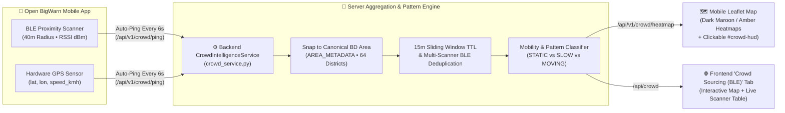

# 📡 BLE Proximity Crowd-Sourcing & Live Mobility Heatmap Guide

This document explains how **BigWarn** detects real-time crowd size, static vs. moving crowd behavior, and spatial congestion patterns across Bangladesh using **Passive Bluetooth Low Energy (BLE) Proximity Scanning + Hardware GPS Velocity**, and how this data is visualized on both the **Mobile App Map** and the **Frontend Web Console (`📡 Crowd Sourcing (BLE)`)**.

---

## 1. Core Concept: Why BLE Proximity Scanning Works With Even 1 App User

A single smartphone's GPS sensor only knows the location of that **1 phone**. However, every modern smartphone, smartwatch, wireless earbud, and vehicle continuously broadcasts anonymous **Bluetooth Low Energy (BLE) advertising packets** within a **`30–50 meter` radius**.

When a commuter opens the **BigWarn Mobile App**:
1. Their phone acts as a **mobile BLE crowd sensor**, passively counting the nearby BLE advertisements around them (`ble_count`) and measuring their RSSI signal strength (`avg_rssi_dbm`, e.g., `-58 dBm` to `-74 dBm`).
2. Simultaneously, the phone reads its **hardware GPS coordinates (`lat`, `lon`) and travel velocity (`speed_kmh`)** via `expo-location`.
3. By combining **RSSI signal stability** ($\Delta\text{RSSI}$ over consecutive scans) with the scanner phone's **GPS velocity (`km/h`)**, the app and server determine how many devices around the user are **STATIC / STUCK** versus **MOVING**.
4. Even **1 open BigWarn app user** standing in a blockade at Mirpur-10 or Shahbagh can detect **50–140+ nearby BLE devices** around them without needing those other people to install the app.

---

## 2. End-to-End Architecture & Data Flow

---

## 3. Step-by-Step Technical Breakdown

### 3.1 Mobile BLE Proximity Scanner ([mobile/src/services/bleCrowdScanner.ts](file:///Users/sabihakhairohi/Projects/news-alert/real-time-alert/mobile/src/services/bleCrowdScanner.ts))

When the user opens the mobile app ([mobile/App.tsx](file:///Users/sabihakhairohi/Projects/news-alert/real-time-alert/mobile/App.tsx#L417-L458)):
1. **`scanNearbyBleCrowd(lat, lon, speedKmh)`** runs automatically on startup and on every 6-second refresh cycle.
2. **Peer Tracking & RSSI Stability**:
   - Discovered BLE peers are tracked in a sliding 45-second window (`peerCache`) storing `{ id, firstRssi, lastRssi, seenCount, lastSeenMs }`.
   - **Static vs. Moving Peer Split**:
     - A nearby BLE peer is classified as **Static (`bleStaticCount`)** when the scanner's GPS velocity is `< 3.5 km/h` and the peer's signal delta $|\text{lastRssi} - \text{firstRssi}| \le 5\text{ dBm}$.
     - Otherwise, the peer is classified as **Moving (`bleMovingCount`)**.
3. **Automatic Telemetry Transmission**:
   - The app sends the accumulated packet to `/api/v1/crowd/ping`:
     - `device_id`: Unique app instance ID (e.g., `bw-android-a8f39c`)
     - `device_label`: Human-readable scanner label (e.g., `BigWarn ANDROID (f39c)`)
     - `lat`, `lon`, `speed_kmh`, `accuracy_m`
     - `ble_count`: Total nearby BLE devices detected within `40m`
     - `ble_static_count` & `ble_moving_count`
     - `avg_rssi_dbm`: Average BLE signal strength in `dBm`
     - `scan_radius_m`: `40` meters

---

### 3.2 Backend Aggregation, Deduplication & Mobility Pattern Classifier ([backend/app/services/crowd_service.py](file:///Users/sabihakhairohi/Projects/news-alert/real-time-alert/backend/app/services/crowd_service.py))

When `/api/v1/crowd/ping` receives a scan from an open app user:

1. **Bangladesh Geofence Verification & Area Snapping**:
   - Validates that `20.50°N <= lat <= 26.70°N` and `88.00°E <= lon <= 92.80°E`.
   - Uses Haversine distance (`snap_to_bangladesh_area`) to snap the coordinates to the nearest canonical Bangladesh neighborhood or district in `AREA_METADATA`.
2. **Crowd Around Each Open App User (`total_crowd_around_me`)**:
   $$\text{total\_crowd\_around\_me} = 1\text{ (scanner phone)} + \text{ble\_count}$$
3. **Spatial Density per $100\text{ m}^2$**:
   With a BLE scan radius $r = 40\text{ m}$ ($\text{Area} = \pi r^2 \approx 5,026.5\text{ m}^2$):
   $$\text{density\_per\_100m2} = \frac{\text{total\_crowd\_around\_me}}{\pi r^2} \times 100$$
4. **Multi-Scanner Area Deduplication**:
   If multiple BigWarn app users ($N_{\text{scanners}} > 1$) are open in the same area at the same time, their overlapping BLE rings are deduplicated using an overlap factor (`0.78` for 2 scanners, `0.65` for 3+ scanners):
   $$\text{total\_mobiles} = N_{\text{scanners}} + \text{round}\left(\text{overlap\_factor} \times \sum_{i=1}^{N_{\text{scanners}}} \text{ble\_count}_i\right)$$
5. **Mobility State & Crowd Pattern Classification (`classify_crowd_pattern`)**:

| Mobility State | Trigger Condition | Crowd Pattern Classification (Based on Peak Threshold) | Heatmap Color |
| :--- | :--- | :--- | :--- |
| **`🔴 STATIC`** | `static_percent >= 68%` **or** `speed_kmh < 3.5 km/h` | • **Very Dense ($\ge 1.45\times$ peak)**: *"Dense Static Gathering / Standstill Blockade"* • **Dense ($\ge 1.0\times$ peak)**: *"High-Density Static Crowd / Bottleneck"* • **Moderate ($\ge 15$ devices)**: *"Stationary Commuter Cluster / Queue"* • **Light ($< 15$ devices)**: *"Localized Static Presence"* | **Dark Crimson / Deep Maroon** (`#7F1D1D` $\rightarrow$ `#3B0707`) |
| **`🟡 SLOW_MOVING`** | `42% <= static_percent < 68%` **or** `3.5 <= speed_kmh < 10.0 km/h` | • **Dense ($\ge 1.0\times$ peak)**: *"Slow-Moving Crowd Surge / Procession"* • **Moderate**: *"Slow Crawling Traffic Corridor"* | **Warm Amber / Deep Orange** (`#F59E0B` $\rightarrow$ `#EA580C`) |
| **`🟢 MOVING`** | `static_percent < 42%` **and** `speed_kmh >= 10.0 km/h` | • **Dense ($\ge 1.0\times$ peak)**: *"High-Volume Moving Transit Flow"* • **Moderate**: *"Normal Free-Flowing Movement"* | **Emerald / Amber Flow** (`#16A34A` $\rightarrow$ `#F59E0B`) |

---

### 3.3 Mobile Map BLE Heatmap & Clickable HUD ([mobile/src/components/OsmMapWebView.tsx](file:///Users/sabihakhairohi/Projects/news-alert/real-time-alert/mobile/src/components/OsmMapWebView.tsx#L602-L660))

On the mobile map:
- Active BLE crowd zones are rendered on `heatmapLayerGroup` using `L.heatLayer` and concentric clickable thermal circles.
- **Tapping any heatmap on the mobile map** opens the floating `#crowd-hud` card at the bottom of the screen showing:
  - **Area Name** (`📡 Mirpur-10`) & **Mobility State Badge** (`🔴 STATIC CROWD` / `🟡 SLOW CROWD` / `🟢 MOVING FLOW`)
  - **Detected Crowd Pattern** (e.g., *"High-Density Static Crowd / Bottleneck"*)
  - **Scanner Summary** (e.g., *"1 Open App Scanner(s) • 58 BLE Peers (-61 dBm)"*)
  - **3 Stat Boxes**: **BLE Crowd (`total_mobiles`)**, **Static / Stuck (`%`)**, and **Moving (`%`)**
  - **Static vs. Moving Progress Bar** and **Avg GPS Speed (`km/h`)**.

---

### 3.4 Frontend Web Console: `📡 Crowd Sourcing (BLE)` Feature Tab ([frontend/src/components/features/crowd/ble-crowd-dashboard.tsx](file:///Users/sabihakhairohi/Projects/news-alert/real-time-alert/frontend/src/components/features/crowd/ble-crowd-dashboard.tsx))

In the Next.js Web Console, clicking the **`📡 Crowd Sourcing (BLE)`** tab (in the top navigation bar on desktop or the bottom thumb-navigation bar on mobile) displays:

1. **Open-App BLE Scanner Controls & Multi-User Mesh Broadcaster**:
   - Automatically pings the server when opened (`🟢 Auto-Ping From Open App: ON`), and lets you test or inspect any Bangladesh location, BLE peer density (`4–140 BLE`), and scanner GPS speed (`0–30 km/h`), or broadcast a 4-area multi-user BLE mesh across Bangladesh.
2. **4 Live BLE Telemetry KPI Cards**:
   - **📱 Open App BLE Scanners**: Total active app instances currently scanning BLE.
   - **📡 Accumulated BLE Crowd**: Total scanners + nearby BLE peers detected.
   - **🔴 Static / Stuck Crowd**: Count and percentage of stationary devices (`< 3.5 km/h`).
   - **🟢 Moving Crowd Flow**: Count and percentage of moving devices (`>= 3.5 km/h`).
3. **Interactive Bangladesh BLE Crowd Heatmap Map**:
   - Full Leaflet + OpenStreetMap canvas rendering live BLE heatmaps and pulsing `📡 Area • N BLE` badges. Clicking any heatmap opens the detailed HUD overlay.
4. **Live BLE Crowd Telemetry Table (*"Crowd Around Each Open App User"*)**:
   - Displays every active open-app scanner in real time with:
     - **Open App Scanner** (`device_label`, `device_id`, live pulsing indicator)
     - **Location (Area & GPS)** (`Area`, `City`, `lat°N, lon°E`)
     - **Crowd Around Me** (`total_crowd_around_me` vs. `peak_threshold`)
     - **BLE Peers (`40m` radius)** (`+N BLE`)
     - **Static vs. Moving Split** (exact counts, percentages, and visual red/green progress bar)
     - **Mobility State Badge** (`🔴 STATIC / STUCK`, `🟡 SLOW CRAWL`, `🟢 MOVING`)
     - **Detected Crowd Pattern** (e.g., *"Dense Static Gathering / Standstill Blockade"*)
     - **GPS Speed (`km/h`)**, **BLE Signal (`dBm`) / Spatial Density (`/100m²`)**, and **Last Ping Age (`LIVE now`)**.
   - Clicking any row in the live table flies the map directly to that user's location and opens their heatmap HUD.

---

## 4. API Endpoints Reference

| Endpoint | Method | Purpose |
| :--- | :--- | :--- |
| `/api/v1/crowd/ping` | `GET` / `POST` | Ingests a live BLE proximity scan + GPS velocity ping from an open mobile or web client (`device_id`, `device_label`, `lat`, `lon`, `speed_kmh`, `ble_count`, `ble_static_count`, `ble_moving_count`, `avg_rssi_dbm`, `scan_radius_m`). |
| `/api/v1/crowd/heatmap` | `GET` | Returns the live BLE crowd snapshot containing `summary` KPIs, `scanners` (rows for the live table), and `heatmaps` (aggregated area heatmap zones for the map). |
| `/api/crowd` | `GET` / `POST` | Next.js frontend proxy route ([frontend/src/app/api/crowd/route.ts](file:///Users/sabihakhairohi/Projects/news-alert/real-time-alert/frontend/src/app/api/crowd/route.ts)) that syncs browser and mobile BLE pings with the backend server. |
