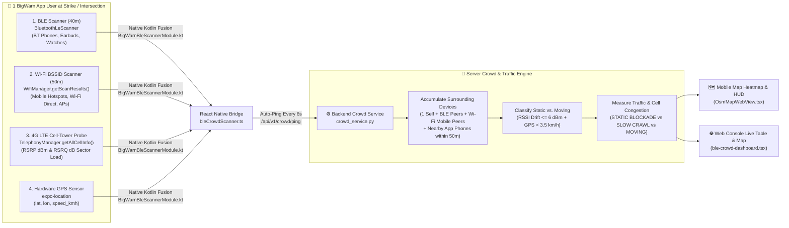

# 📋 Implementation Plan: Single-Phone Multi-Radio Surroundings & Traffic Detection (`BLE + Wi-Fi + 4G Cell Load + GPS`)

**Objective:** Enable **just 1 or 2 people** who have downloaded the **BigWarn Mobile App** to accurately detect the number of devices surrounding them during a strike, protest, or road blockade—**even when the surrounding people do NOT have the BigWarn app installed and do NOT have Bluetooth turned on**—and measure whether traffic in that area is **Static (Blocked)** or **Moving**.

---

## 1. Problem Statement & Core Insight

During a real-world strike or road blockade in Bangladesh:
1. We cannot expect hundreds of people in the crowd to download the BigWarn app.
2. Many people in the crowd keep **Bluetooth turned OFF** to save battery.
3. However, if **even 1 or 2 people** at the scene have BigWarn installed on their Android phone, that single phone has **four physical hardware radio sensors** that can passively scan the surrounding `40m–50m` environment without requiring anyone else to install the app:

| Hardware Sensor on the User's Phone | Android Native API | What It Detects Around the User (Within 40–50m) | Works When Others Have Bluetooth OFF? |
| :--- | :--- | :--- | :---: |
| **1. Wi-Fi Radio & Mobile Hotspot / P2P Scanner** | `WifiManager.getScanResults()` | Surrounding phones with Wi-Fi ON, Personal Hotspots (`Redmi`, `Galaxy`, `vivo`, `iPhone`), Wi-Fi Direct (`DIRECT-*`), vehicle Wi-Fi, and nearby APs. | ✅ **YES** |
| **2. Bluetooth Low Energy (BLE) Scanner** | `BluetoothLeScanner.startScan()` | Surrounding phones with BT on, wireless earbuds (Oraimo, AirPods, Realme), smartwatches, car stereos, and Google/Apple "Find My" beacons. | ⚪ Detects BT/Wearables |
| **3. 4G/LTE Cell-Tower Sector Load** | `TelephonyManager.getAllCellInfo()` | Measures `RSRQ` (signal interference quality in `dB`) vs. `RSRP` (signal power in `dBm`) on the serving cell tower sector—which drops sharply when hundreds of active SIM cards pack into one intersection. | ✅ **YES (100% of phones have SIM on)** |
| **4. Hardware GPS Velocity & Dwell** | `expo-location` (`coords.speed`) | Measures the user's exact travel speed (`km/h`) and stationary dwell duration to determine if traffic is blocked (`< 3.5 km/h`) or moving. | ✅ **YES** |

---

## 2. End-to-End Multi-Radio Sensor Fusion Architecture



---

## 3. Detailed Implementation Plan (4 Phases)

### Phase 1: Upgrade Native Android Scanner to Multi-Radio (`BLE + Wi-Fi + 4G Cell Load`)

#### 1.1 Update Android Permissions ([mobile/android/app/src/main/AndroidManifest.xml](file:///Users/sabihakhairohi/Projects/news-alert/real-time-alert/mobile/android/app/src/main/AndroidManifest.xml) & [mobile/app.json](file:///Users/sabihakhairohi/Projects/news-alert/real-time-alert/mobile/app.json))
Add built-in Android Wi-Fi scanning permissions alongside existing Bluetooth and Location permissions (no extra runtime popup required for `ACCESS_WIFI_STATE` / `CHANGE_WIFI_STATE` when `ACCESS_FINE_LOCATION` is already granted):
- `android.permission.ACCESS_WIFI_STATE`
- `android.permission.CHANGE_WIFI_STATE`
- `android.permission.BLUETOOTH_SCAN`
- `android.permission.BLUETOOTH_CONNECT`
- `android.permission.ACCESS_FINE_LOCATION`

#### 1.2 Upgrade [BigWarnBleScannerModule.kt](file:///Users/sabihakhairohi/Projects/news-alert/real-time-alert/mobile/android/app/src/main/java/com/bigwarn/edge/BigWarnBleScannerModule.kt)
Extend `BigWarnBleScannerModule.kt` to scan and fuse three hardware radios on the phone:

1. **Radio A — Hardware BLE Scanner (`BluetoothLeScanner`)**:
   - Tracks unique BLE MAC/advertising addresses (`peers`) heard within the last `45 seconds` with `rssi >= -95 dBm`.
   - Computes `bleCount`, `bleStaticCount` ($|\Delta\text{RSSI}| \le 6\text{ dBm}$ and `speedKmh < 3.5`), and `bleMovingCount`.
2. **Radio B — Hardware Wi-Fi Surroundings Scanner (`WifiManager.getScanResults()`)**:
   - Calls `wifiManager.startScan()` (throttled to Android's OS limit of 4 active triggers per 2 minutes) and reads `wifiManager.scanResults` on every 6-second cycle (which continuously returns cached + fresh hardware Wi-Fi beacons).
   - Filters for recent signals (`rssi >= -90 dBm`, within `~50m`) and classifies each unique BSSID (`MAC address`) into:
     - **Mobile / Portable Wi-Fi Devices (`wifiMobileCount`)**:
       - BSSIDs with the **IEEE 802.11 Locally Administered MAC bit** set (`second hex char in {'2', '6', 'a', 'e', 'A', 'E'}`—standard on Android/iOS mobile hotspots and Wi-Fi Direct peers), **OR**
       - SSIDs matching mobile/vehicle patterns (`AndroidAP`, `Galaxy`, `Redmi`, `POCO`, `vivo`, `OPPO`, `realme`, `iPhone`, `Symphony`, `Walton`, `Infinix`, `tecno`, `DIRECT-`).
     - **Fixed Infrastructure APs (`wifiFixedApCount`)**: Roadside shop/office routers.
   - Tracks each Wi-Fi BSSID in a 45-second sliding map (`wifiPeers`) and classifies mobile Wi-Fi peers into **Static (`wifiStaticCount`)** vs. **Moving (`wifiMovingCount`)** based on RSSI drift ($|\Delta\text{RSSI}| \le 6\text{ dBm}$) and user GPS speed.
3. **Radio C — 4G/LTE Cell-Tower Sector Load Probe (`TelephonyManager.getAllCellInfo()`)**:
   - Reads the registered `CellInfoLte` / `CellInfoNr` (5G) / `CellInfoWcdma` signal metrics:
     - `cellRsrpDbm` (e.g., `-82 dBm`)
     - `cellRsrqDb` (e.g., `-15 dB`)
   - Computes `cellLoadPercent` (`0–100%`) from `RSRQ`:
     $$\text{cellLoadPercent} = \text{clamp}\left(\frac{-5 - \text{RSRQ}}{15} \times 100,\ 10,\ 100\right)$$
     *(An `RSRQ` of `-5 dB` = `10%` light load; `-12 dB` = `55%` moderate load; `-18 dB` = `90%+` heavy crowd saturation on the cell tower).*

---

### Phase 2: Upgrade Mobile JS Bridge ([mobile/src/services/bleCrowdScanner.ts](file:///Users/sabihakhairohi/Projects/news-alert/real-time-alert/mobile/src/services/bleCrowdScanner.ts) & [mobile/App.tsx](file:///Users/sabihakhairohi/Projects/news-alert/real-time-alert/mobile/App.tsx))

1. Update `BleScanTelemetry` interface in `bleCrowdScanner.ts` to return the real hardware multi-radio breakdown:
   ```ts
   export interface BleScanTelemetry {
     bleCount: number;           // Real BLE devices (40m)
     bleStaticCount: number;
     bleMovingCount: number;
     wifiMobileCount: number;    // Real Wi-Fi mobile devices/hotspots with BT off (50m)
     wifiFixedApCount: number;   // Nearby fixed Wi-Fi routers
     wifiStaticCount: number;
     wifiMovingCount: number;
     cellRsrpDbm: number;        // 4G LTE tower power (dBm)
     cellRsrqDb: number;         // 4G LTE tower interference quality (dB)
     cellLoadPercent: number;    // 0-100% cell sector saturation
     avgRssiDbm: number;
     scanRadiusM: number;
     isScanning: boolean;
     scannerMode: string;
   }
   ```
2. In `mobile/App.tsx`, transmit `ble_count`, `wifi_mobile_count`, `wifi_ap_count`, `cell_rsrq_db`, `cell_load_percent`, and `speed_kmh` to `/api/v1/crowd/ping`.

---

### Phase 3: Upgrade Backend Multi-Radio Crowd & Traffic Engine ([backend/app/services/crowd_service.py](file:///Users/sabihakhairohi/Projects/news-alert/real-time-alert/backend/app/services/crowd_service.py) & [backend/app/api/server.py](file:///Users/sabihakhairohi/Projects/news-alert/real-time-alert/backend/app/api/server.py))

1. **Surrounding Device Accumulation Formula (Per Opened App User)**:
   For each opened BigWarn phone $i$:
   $$\text{surrounding\_peers}_i = N_{\text{BLE}, i} + N_{\text{Wi-Fi Mobile}, i} + N_{\text{Nearby BigWarn Apps (50m)}, i}$$
   $$\text{total\_crowd\_around\_me}_i = 1\text{ (self)} + \text{surrounding\_peers}_i$$
   *(All counts come strictly from real hardware BLE packets, real hardware Wi-Fi BSSID scans, and real nearby open app phones—zero fake or random numbers.)*
2. **Traffic & Crowd Pattern Classifier**:
   Combines `total_crowd_around_me`, `static_percent`, `speed_kmh`, and `cell_load_percent` to determine:
   - **`🔴 STATIC / BLOCKED TRAFFIC`**: `speed_kmh < 3.5 km/h` and `static_percent >= 68%`
     - If `total_crowd_around_me >= peak_threshold` or `cell_load_percent >= 75%`: **"Strike / Standstill Road Blockade (High Cell & Radio Density)"**
     - Else if `total_crowd_around_me >= 10`: **"Stationary Traffic Queue / Bottleneck"**
     - Else: **"Localized Static Presence"**
   - **`🟡 SLOW CRAWLING TRAFFIC`**: `3.5 <= speed_kmh < 10.0 km/h`
     - **"Slow-Moving Procession / Congested Traffic"**
   - **`🟢 FREE-FLOWING TRAFFIC`**: `speed_kmh >= 10.0 km/h`
     - **"Normal Moving Traffic Flow"**

---

### Phase 4: Upgrade Mobile Map HUD & Frontend Live Table ([OsmMapWebView.tsx](file:///Users/sabihakhairohi/Projects/news-alert/real-time-alert/mobile/src/components/OsmMapWebView.tsx) & [ble-crowd-dashboard.tsx](file:///Users/sabihakhairohi/Projects/news-alert/real-time-alert/frontend/src/components/features/crowd/ble-crowd-dashboard.tsx))

1. **Mobile Map `#crowd-hud`**:
   - Shows **Total Surrounding Devices**, **BLE Peers (`40m`)**, **Wi-Fi Mobile Peers (`50m`, Bluetooth OFF)**, **Static vs. Moving (`%`)**, **4G Cell Sector Load (`%`)**, and **Measured Traffic Speed (`km/h`)**.
2. **Frontend `📡 Crowd Sourcing` Live Table**:
   - Displays per opened app user:
     - **Opened App User** (`device_label`, `device_id`)
     - **Location (Area & GPS)**
     - **Crowd Around Opened App User** (`1 + BLE + Wi-Fi Mobile Peers`)
     - **Radio Breakdown** (`+X BLE` • `+Y Wi-Fi (BT Off)` • `Cell Load Z%`)
     - **Static vs. Moving Split Bar**
     - **Traffic / Mobility State** (`🔴 STATIC / BLOCKED`, `🟡 SLOW CRAWL`, `🟢 MOVING`)
     - **Detected Crowd & Traffic Pattern**
     - **GPS Traffic Speed (`km/h`)**, **Signal (`dBm`)**, and **Last Ping (`LIVE now`)**.

---

## 4. Verification & Build Steps

1. Run TypeScript checks in `mobile/` and `frontend/` (`npx tsc --noEmit`).
2. Run Python verification on `crowd_service.py` to confirm multi-radio ingestion (`ble_count + wifi_mobile_count + cell_load_percent`).
3. Rebuild the Android APK via `./real-time-alert/mobile/build_apk.sh` and deploy backend changes via `./real-time-alert/backend/deploy.sh`.
